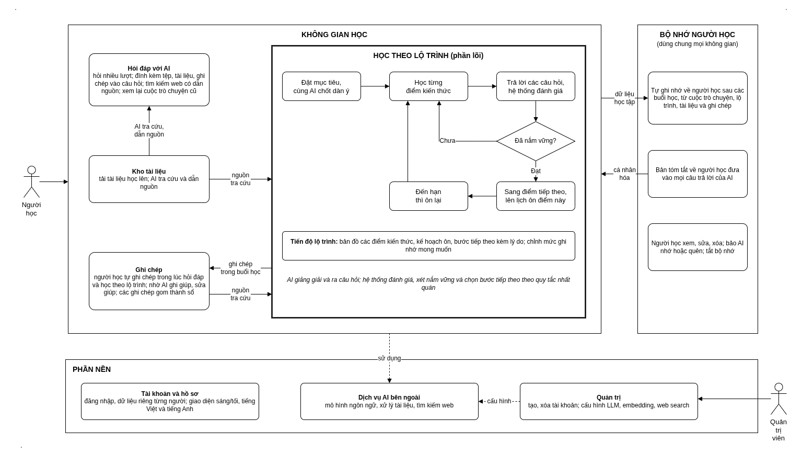

# Masterly

Không gian học tập AI cá nhân hóa, thích ứng theo tiến trình người học.

Masterly giúp người học học có hệ thống: đặt mục tiêu, học theo lộ trình,
được kiểm tra đến khi nắm vững và được nhắc ôn tập đúng lúc. Việc đánh giá người
học đã nắm vững hay chưa do hệ thống quyết định theo quy tắc nhất quán, AI đảm
nhận việc giảng giải và đặt câu hỏi.

## Chức năng chính

**Học theo lộ trình (phần lõi)**

- **Lập lộ trình từ mục tiêu:** nêu mục tiêu học, có thể kèm tài liệu, rồi cùng
  AI chốt dàn ý gồm các điểm kiến thức.
- **Học đến khi nắm vững:** học từng điểm kiến thức, trả lời câu hỏi, được chấm
  và chỉ sang điểm tiếp theo khi đã nắm vững.
- **Ôn tập theo lịch:** hệ thống tự xếp lịch và nhắc ôn những điểm đã học khi
  đến hạn.

**Hỏi đáp tự do**

- **Hỏi đáp với AI:** đặt câu hỏi, nhận giải thích, trao đổi nhiều lượt; AI tra
  cứu tài liệu của người học hoặc tìm trên web khi cần.

**Tài liệu và ghi chép**

- **Kho tài liệu:** tải lên và sắp xếp tài liệu học để
  AI tra cứu và dẫn nguồn khi trả lời.
- **Ghi chép trong lúc học:** tự ghi chép trong lúc hỏi đáp hay học theo lộ trình,
  nhờ AI ghi giúp hoặc sửa lại; các ghi chép tạo thành sổ ghi chép để xem lại và
  dùng làm nguồn cho việc học sau.

**Cá nhân hóa và tổ chức**

- **Bộ nhớ người học:** hệ thống ghi nhớ thông tin về người học qua các buổi học
  để cá nhân hóa câu trả lời; người học xem, sửa, xóa được.
- **Không gian học:** mỗi môn học một không gian, giữ các cuộc trò chuyện, lộ
  trình, tài liệu và ghi chép của cùng một chủ đề ở cùng nhau.

**Tài khoản và quản trị**

- Mỗi người dùng có tài khoản và dữ liệu riêng.
- Quản trị viên tạo, xóa tài khoản và cấu hình mô hình AI dùng chung cho hệ thống.

## Trạng thái

Đang phát triển.
<!-- 
## Giấy phép

Apache License 2.0 — xem [LICENSE](LICENSE). -->

<!--

Một số thành phần được phát triển từ mã nguồn mở theo Apache License 2.0
và đã được sửa đổi.

-->
