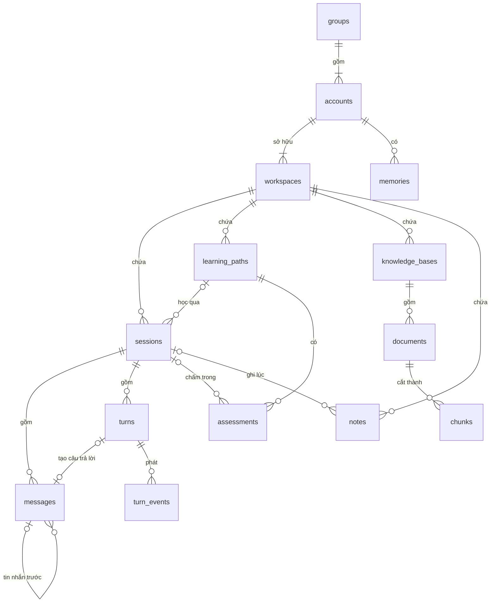

# Thiết kế cơ sở dữ liệu

Bản thiết kế lưu trữ cho bản chạy thật của Masterly, triển khai trên AWS. Đây là
nguyên liệu cho mục thiết kế cơ sở dữ liệu ở chương 3, và là căn cứ khi tạo bảng
cho từng chức năng.

Liên quan đặc tả: mục 2.2.1 (tác nhân Chủ nhóm và Người học, nhóm tách biệt nhau),
mục 2.3 (dữ liệu mỗi người tách riêng; khóa truy cập không bao giờ hiển thị đầy đủ).

## 1. Tổng quan

| Dữ liệu | Khi phát triển | Trên AWS |
|---|---|---|
| Dữ liệu nghiệp vụ và vector tài liệu | PostgreSQL (pgvector) trong Docker | RDS PostgreSQL (pgvector) |
| Tệp: tài liệu gốc, ảnh đại diện, tệp đính kèm | Thư mục trên máy | S3 |
| Bí mật và cấu hình triển khai | Tệp `.env` | Secrets Manager, đưa vào biến môi trường |

Nguyên tắc:

- Một cơ sở dữ liệu chung; dữ liệu các nhóm và người dùng tách nhau bằng khóa ngoại.
- Mỗi thực thể một bảng. Phần chỉ đọc và ghi cả khối, không cần nối hay lọc, để
  trong cột `jsonb` của chính bảng đó, không tách bảng phụ.
- Mã định danh UUID; thời gian `timestamptz`.
- Xóa tài khoản thì xóa theo mọi dữ liệu của tài khoản (`ON DELETE CASCADE`).
- Khóa API và phiên ChatGPT được mã hóa trước khi lưu.
- Thay đổi cấu trúc bảng qua migration (Alembic); truy cập qua SQLAlchemy 2.

## 2. Sơ đồ thực thể – liên kết



14 bảng, chia ba vùng:

- Nhóm và tài khoản: `groups`, `accounts`.
- Theo tài khoản: `workspaces`, `memories`.
- Theo không gian học: trò chuyện (`sessions`, `messages`, `turns`, `turn_events`),
  lộ trình (`learning_paths`, `assessments`), tài liệu (`knowledge_bases`,
  `documents`, `chunks`), ghi chép (`notes`).

## 3. Các bảng

### 3.1. Nhóm và tài khoản

`groups`: một nhóm, lập khi chủ nhóm đăng ký; giữ luôn cấu hình dịch vụ của nhóm.

| Cột | Kiểu | Ý nghĩa |
|---|---|---|
| id | uuid, PK | |
| model_catalog | jsonb | Cấu hình dịch vụ AI của nhóm (xem dưới bảng) |
| catalog_revision | int | Tăng mỗi lần cấu hình đổi |
| codex_session | bytea | Phiên đăng nhập ChatGPT, đã mã hóa |
| created_at | timestamptz | |

`model_catalog` gồm hai phần:

- `connections`: các nhà cung cấp đã khai báo (loại, địa chỉ, khóa API). Mỗi nhà cung
  cấp nhập một lần và dùng chung cho nhiều dịch vụ, ví dụ một khóa OpenAI vừa cho trả
  lời vừa cho embedding.
- `services`: bốn dịch vụ là trả lời (`llm`), việc nền (`task`), embedding và tìm
  kiếm (`search`). Mỗi dịch vụ có danh sách cấu hình, mỗi cấu hình trỏ tới một nhà
  cung cấp và chứa các mô hình; kèm cấu hình và mô hình đang dùng. Riêng `task` có
  thêm mô hình chọn riêng cho từng việc nền.

Mỗi thay đổi của chủ nhóm (lưu một nhà cung cấp, thêm mô hình, đổi mô hình đang dùng)
có hiệu lực ngay, không qua bản nháp: backend đọc `model_catalog`, sửa đúng phần đó,
ghi lại và tăng `catalog_revision`. Backend giữ bản cấu hình đã giải mã trong bộ nhớ
theo từng nhóm và làm mới khi `catalog_revision` đổi. Khóa API được mã hóa từng giá trị
trước khi ghi, chỉ giải mã trong backend lúc gọi nhà cung cấp, và không bao giờ gửi ra
trình duyệt.

`accounts`: mọi tài khoản, cả chủ nhóm và người học.

| Cột | Kiểu | Ý nghĩa |
|---|---|---|
| id | uuid, PK | |
| group_id | uuid, FK `groups` | Nhóm của tài khoản |
| role | text | `owner` hoặc `learner` |
| email | text, duy nhất | Dùng để đăng nhập |
| password_hash | text | Băm bằng bcrypt |
| display_name | text | |
| avatar | text | Rỗng, `icon:<name>:<color>` hoặc khóa tệp ảnh |
| theme, language | text | Cài đặt giao diện |
| disabled | bool | Khóa tài khoản |
| created_at | timestamptz | Ngày tham gia |

- Mỗi nhóm có đúng một `owner`: ràng buộc duy nhất trên `group_id` với điều kiện
  `role = 'owner'`.
- Đăng ký: tạo nhóm và tài khoản chủ nhóm trong cùng một giao dịch.

### 3.2. Theo tài khoản

`workspaces`: không gian học.

| Cột | Kiểu | Ý nghĩa |
|---|---|---|
| id | uuid, PK | |
| account_id | uuid, FK `accounts` | |
| name | text | |
| is_default | bool | Không gian mặc định, tạo cùng tài khoản |
| archived_at | timestamptz | Đã lưu trữ |
| created_at | timestamptz | |

`memories`: bộ nhớ người học, dùng chung cho mọi không gian.

| Cột | Kiểu | Ý nghĩa |
|---|---|---|
| account_id | uuid, PK, FK `accounts` | |
| slot | text, PK | Phần bộ nhớ (xem dưới bảng) |
| content | text | Markdown; người học xem, sửa, xóa được |
| updated_at | timestamptz | |

Có hai loại phần bộ nhớ:

- Hồ sơ chung, tổng hợp từ mọi nơi: `profile` (người học là ai), `preferences` (thích
  được giải thích thế nào), `scope` (đã biết, đang học gì), `recent` (các buổi học gần
  đây). AI đọc hồ sơ chung ở mỗi lượt trả lời.
- Tóm tắt theo nơi phát sinh: `surface:chat`, `surface:kb`, `surface:notes`. Cập nhật
  ở nền sau mỗi buổi học, rồi tổng hợp vào hồ sơ chung.

Mỗi ý nhớ trong `content` là một gạch đầu dòng có mã riêng, để xóa hoặc sửa đúng ý đó,
và chú thích nguồn (cuộc trò chuyện, ghi chép hay tài liệu đã sinh ra ý đó).

### 3.3. Trò chuyện

`sessions`: cuộc trò chuyện.

| Cột | Kiểu | Ý nghĩa |
|---|---|---|
| id | uuid, PK | |
| workspace_id | uuid, FK `workspaces` | |
| path_id | uuid, FK `learning_paths`, có thể trống | Lộ trình đang học trong cuộc trò chuyện này |
| title | text | |
| summary | jsonb | Tóm tắt phần đầu khi cuộc trò chuyện dài |
| preferences | jsonb | Chế độ, công cụ, kho tài liệu đang chọn |
| archived_at | timestamptz | |
| created_at, updated_at | timestamptz | |

`messages`: tin nhắn.

| Cột | Kiểu | Ý nghĩa |
|---|---|---|
| id | bigint, PK, tự tăng | |
| session_id | uuid, FK `sessions` | |
| parent_id | bigint, FK `messages` | Tin nhắn trước trên cùng nhánh (sửa tin nhắn thì rẽ nhánh) |
| role | text | `user` hoặc `assistant` |
| content | text | |
| extra | jsonb | Các bước hiển thị kèm, nguồn trích dẫn, tệp đính kèm |
| created_at | timestamptz | |

`turns`: một lượt hỏi đáp đang chạy hoặc đã xong.

| Cột | Kiểu | Ý nghĩa |
|---|---|---|
| id | uuid, PK | |
| session_id | uuid, FK `sessions` | |
| message_id | bigint, FK `messages` | Câu trả lời của lượt |
| status | text | `running`, `completed`, `failed`, `cancelled` |
| error | text | |
| created_at, finished_at | timestamptz | |

`turn_events`: sự kiện phát ra trong lượt, để phát lại khi tải lại trang hay mất kết
nối.

| Cột | Kiểu | Ý nghĩa |
|---|---|---|
| turn_id | uuid, PK, FK `turns` | |
| seq | int, PK | Thứ tự |
| type | text | |
| data | jsonb | |
| created_at | timestamptz | |

### 3.4. Lộ trình

`learning_paths`

| Cột | Kiểu | Ý nghĩa |
|---|---|---|
| id | uuid, PK | |
| workspace_id | uuid, FK `workspaces` | |
| goal | text | Mục tiêu học |
| status | text | `active` hoặc `archived` |
| state | jsonb | Học phần, điểm kiến thức, mức nắm vững, lịch ôn, câu hỏi đang chờ trả lời, nguồn của lộ trình |
| revision | int | Tăng mỗi lần ghi; chỉ ghi khi revision khớp, tránh hai lượt ghi đè nhau |
| created_at, updated_at | timestamptz | |

`assessments`: mỗi câu trả lời đã chấm là một dòng; là căn cứ để xét nắm vững và
xếp lịch ôn.

| Cột | Kiểu | Ý nghĩa |
|---|---|---|
| id | uuid, PK | |
| path_id | uuid, FK `learning_paths` | |
| knowledge_point_id | text | Điểm kiến thức (mã trong `state`) |
| session_id | uuid, FK `sessions`, có thể trống | |
| kind | text | `quiz`, `qualitative`, `review` |
| result | text | `correct`, `incorrect`, `partial` |
| question | jsonb | Câu hỏi, đáp án, câu trả lời của người học, nhận xét của AI |
| detail | jsonb | Số lần thử, số gợi ý, độ tự tin, thời gian trả lời |
| created_at | timestamptz | |

### 3.5. Tài liệu

`knowledge_bases`

| Cột | Kiểu | Ý nghĩa |
|---|---|---|
| id | uuid, PK | |
| workspace_id | uuid, FK `workspaces` | |
| name | text | |
| embedding_model | text | Mô hình và số chiều đã dùng; đổi mô hình thì biết phải xử lý lại |
| created_at | timestamptz | |

`documents`

| Cột | Kiểu | Ý nghĩa |
|---|---|---|
| id | uuid, PK | |
| knowledge_base_id | uuid, FK `knowledge_bases` | Kho tài liệu chứa tài liệu này |
| folder | text | Đường dẫn thư mục trong kho, ví dụ `Chương 1/Bài đọc` |
| file_name | text | |
| storage_key | text | Khóa tệp gốc trên S3 (hoặc thư mục) |
| size_bytes | bigint | |
| status | text | `processing`, `ready`, `failed` |
| error | text | Lỗi xử lý, để thử lại |
| created_at | timestamptz | |

`chunks`: đoạn văn cắt từ tài liệu.

| Cột | Kiểu | Ý nghĩa |
|---|---|---|
| id | uuid, PK | |
| document_id | uuid, FK `documents` | |
| ordinal | int | Thứ tự trong tài liệu, để ghép lại toàn văn |
| content | text | |
| locator | jsonb | Trang, chương, mục |
| embedding | vector | Tìm theo nghĩa (chỉ mục HNSW) |
| search_text | tsvector | Tìm theo từ khóa (chỉ mục GIN), sinh từ `content` |

### 3.6. Ghi chép

`notes`

| Cột | Kiểu | Ý nghĩa |
|---|---|---|
| id | uuid, PK | |
| workspace_id | uuid, FK `workspaces` | |
| session_id | uuid, FK `sessions`, có thể trống | Cuộc trò chuyện đang mở khi ghi |
| title | text | |
| content | text | Markdown |
| created_at, updated_at | timestamptz | |

## 4. Lưu tệp

- Tệp tải lên đi qua backend: backend kiểm tra loại và kích thước, lưu bản gốc, ghi
  `documents` với trạng thái `processing` rồi trả lời ngay; việc xử lý chạy nền.
  Thử lại hoặc đổi mô hình embedding thì đọc lại bản gốc.
- Mã gọi một lớp lưu tệp chung, có hai cách lưu: thư mục khi phát triển, S3 khi
  triển khai. Khóa tệp giống nhau ở cả hai:

```text
<group_id>/<account_id>/avatar/<version>.<ext>
<group_id>/<account_id>/documents/<document_id>.<ext>
<group_id>/<account_id>/attachments/<file_id>.<ext>
```

## 5. Cấu hình triển khai

Cấu hình cần lúc khởi động đặt bằng biến môi trường. Khi phát triển, các biến nằm
trong tệp `.env` (không đưa lên Git; repo có `.env.example` liệt kê tên biến). Trên
AWS, biến bí mật lấy từ Secrets Manager, các biến còn lại đặt trong cấu hình chạy ứng
dụng. Cột "Bí mật" đánh dấu biến không được để lộ.

Backend:

| Nhóm | Biến | Bí mật | Ý nghĩa |
|---|---|---|---|
| Cơ sở dữ liệu | `DB_HOST`, `DB_PORT`, `DB_NAME` | | Máy, cổng và tên cơ sở dữ liệu |
| | `DB_USER` | | Tài khoản kết nối |
| | `DB_PASSWORD` | Có | Mật khẩu kết nối |
| Khóa | `AUTH_SECRET` | Có | Khóa ký phiên đăng nhập |
| | `ENCRYPTION_KEY` | Có | Khóa mã hóa khóa API và phiên ChatGPT |
| Lưu tệp | `STORAGE_BACKEND` | | `local` hoặc `s3` |
| | `STORAGE_LOCAL_DIR` | | Thư mục lưu tệp khi `local` |
| | `S3_BUCKET`, `AWS_REGION` | | Bucket và vùng khi `s3` |
| Mạng | `PUBLIC_URL` | | Địa chỉ công khai của trang web |
| | `CORS_ORIGINS` | | Nguồn được phép gọi API |
| | `BACKEND_PORT` | | Cổng backend |
| Đăng nhập | `SESSION_TTL_HOURS` | | Thời hạn phiên đăng nhập |
| | `COOKIE_SECURE` | | Cookie chỉ gửi qua HTTPS; bật khi chạy thật |
| Giới hạn | `UPLOAD_MAX_MB` | | Kích thước tối đa mỗi tệp tải lên |
| Nhật ký | `LOG_LEVEL` | | Mức ghi nhật ký |

Web:

| Biến | Ý nghĩa |
|---|---|
| `MASTERLY_API_BASE_URL` | Địa chỉ backend, để web chuyển tiếp `/api` |
| `PORT` | Cổng của web |

- Backend tự ghép các biến `DB_*` thành chuỗi kết nối. Trên AWS, Secrets Manager của
  RDS giữ sẵn các trường này và có thể tự đổi mật khẩu định kỳ.
- Quyền đọc ghi S3 trên AWS cấp cho máy chạy ứng dụng bằng IAM role, không đặt khóa
  AWS trong biến môi trường.
- Các tham số khác của ứng dụng (lọc nguồn khi tìm web, giới hạn số chữ của tệp đính
  kèm…) là giá trị mặc định trong mã, không phải biến môi trường. Các tệp cấu hình
  `system.json`, `auth.json` không còn dùng.

## 6. Tạo bảng và các chức năng sử dụng

Toàn bộ bảng được tạo trong migration đầu tiên, khi chuyển sang PostgreSQL. Về sau,
chức năng nào cần đổi bảng thì thêm migration mới và sửa bản thiết kế này trong cùng PR.

| Chức năng | Ghi | Đọc thêm |
|---|---|---|
| F01 Đăng ký và đăng nhập | `groups`, `accounts`, `workspaces` | |
| F02 Cấp và thu hồi tài khoản | `accounts` | |
| F03 Cấu hình dịch vụ bên ngoài | `groups` (cột cấu hình) | |
| F04 Trò chuyện với AI | `sessions`, `messages`, `turns`, `turn_events` | `groups`, `memories`, `chunks` |
| F05 Tổ chức không gian học | `workspaces`, `sessions` | |
| F06 Điều chỉnh bộ nhớ người học | `memories` | `messages` |
| F07 Tải lên và sắp xếp tài liệu học | `knowledge_bases`, `documents`, `chunks` | `groups` |
| F08 Lập lộ trình | `learning_paths`, `sessions` | `messages`, `documents`, `notes` |
| F09 Học một điểm kiến thức | `learning_paths`, `assessments` | `chunks` |
| F10 Ôn tập theo lịch | `learning_paths`, `assessments` | |
| F11 Theo dõi tiến độ lộ trình | `learning_paths` | `assessments` |
| F14 Ghi chép trong lúc học | `notes` | |
