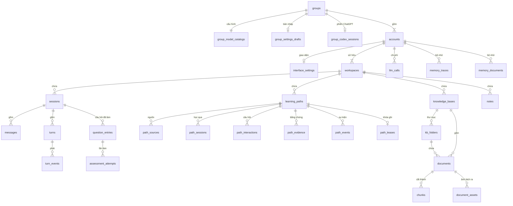

# Thiết kế cơ sở dữ liệu

Bản thiết kế lưu trữ cho bản chạy thật của Masterly, triển khai trên AWS. Đây là
nguyên liệu cho mục thiết kế cơ sở dữ liệu ở chương 3, và là căn cứ khi tạo bảng
cho từng chức năng.

Liên quan đặc tả: mục 2.2.1 (tác nhân Chủ nhóm và Người học, nhóm tách biệt nhau),
mục 2.3 (dữ liệu mỗi người tách riêng; khóa truy cập không bao giờ hiển thị đầy đủ).

## 1. Tổng quan lưu trữ

| Loại dữ liệu | Nơi lưu khi phát triển | Nơi lưu trên AWS |
|---|---|---|
| Dữ liệu nghiệp vụ: tài khoản, cấu hình nhóm, trò chuyện, lộ trình, tài liệu, ghi chép, bộ nhớ | PostgreSQL trong Docker | RDS PostgreSQL |
| Vector của đoạn tài liệu | PostgreSQL, tiện ích pgvector | RDS PostgreSQL, tiện ích pgvector |
| Tệp: tài liệu gốc, ảnh tách từ tài liệu, ảnh đại diện, tệp đính kèm | Thư mục trên máy | S3 |
| Bí mật: khóa ký phiên, khóa mã hóa, thông tin kết nối cơ sở dữ liệu | Tệp `.env` | Secrets Manager, đưa vào biến môi trường |
| Cấu hình triển khai: cổng, CORS, giới hạn tải lên | Tệp `.env` | Biến môi trường |
| Tham số gọi mô hình (`agents.yaml`) | Tệp đi kèm mã | Tệp đi kèm mã |

- Một cơ sở dữ liệu chung cho cả hệ thống. Dữ liệu của các nhóm và các người dùng
  nằm chung bảng, tách nhau bằng khóa ngoại tới nhóm và tài khoản.
- Không lưu gì vào thư mục của máy chạy ứng dụng khi chạy trên AWS: ổ đĩa đó có
  thể mất khi khởi động lại hoặc khi chạy nhiều bản cùng lúc.

## 2. Nguyên tắc thiết kế

- **Mã định danh** là UUID, sinh ở ứng dụng. Thời gian dùng `timestamptz`.
- **Mỗi bản ghi nghiệp vụ có chủ rõ ràng.** Cấu hình gắn với `group_id`; nội dung
  học gắn với `account_id` và `workspace_id`. Mọi truy vấn của một người dùng đều
  lọc theo các cột này.
- **Bảng cho thực thể và quan hệ, `jsonb` cho phần linh hoạt.** Thứ cần nối, lọc,
  sắp xếp hay ràng buộc thì là cột. Phần chỉ đọc và ghi cả khối, hay đổi cấu trúc
  theo phiên bản (nội dung sự kiện của lượt, danh mục mô hình, trạng thái lộ trình)
  thì là cột `jsonb`.
- **Khóa ngoại có quy tắc xóa rõ ràng.** Xóa tài khoản thì xóa theo mọi dữ liệu của
  tài khoản đó (`ON DELETE CASCADE`). Liên kết chỉ để tham chiếu, ví dụ lần làm bài
  trỏ về cuộc trò chuyện, thì để trống khi bên kia bị xóa (`ON DELETE SET NULL`).
- **Bí mật trong cơ sở dữ liệu được mã hóa.** Khóa API của nhà cung cấp và phiên
  ChatGPT được mã hóa bằng khóa mã hóa trước khi ghi; lộ cơ sở dữ liệu cũng không
  lộ khóa.
- **Thay đổi cấu trúc bảng qua migration** (Alembic). Mỗi chức năng thêm bảng của
  mình bằng một migration riêng.
- **Truy cập dữ liệu** qua SQLAlchemy 2 (bất đồng bộ, trình điều khiển `asyncpg`).

## 3. Sơ đồ thực thể – liên kết



Ba vùng của sơ đồ:

- Nhóm và cấu hình: một nhóm có một chủ nhóm và các người học; cấu hình mô hình,
  bản nháp và phiên ChatGPT thuộc về nhóm.
- Tài khoản: mỗi tài khoản có các không gian học, cài đặt giao diện, bộ nhớ và nhật
  ký chi phí của riêng mình.
- Không gian học: chứa các cuộc trò chuyện, lộ trình, kho tài liệu và ghi chép.

## 4. Các bảng

Kiểu `uuid`, `text`, `int`, `bool`, `jsonb`, `timestamptz` là kiểu của PostgreSQL.
"PK" là khóa chính, "FK" là khóa ngoại.

### 4.1. Nhóm và tài khoản (F01, F02)

`groups`: một nhóm do một chủ nhóm lập khi đăng ký.

| Cột | Kiểu | Ràng buộc | Ý nghĩa |
|---|---|---|---|
| id | uuid | PK | |
| owner_id | uuid | FK `accounts`, duy nhất | Chủ nhóm |
| created_at | timestamptz | | |

`accounts`: mọi tài khoản, cả chủ nhóm và người học.

| Cột | Kiểu | Ràng buộc | Ý nghĩa |
|---|---|---|---|
| id | uuid | PK | |
| group_id | uuid | FK `groups`, CASCADE | Nhóm của tài khoản |
| role | text | `owner` hoặc `learner` | Vai trò |
| email | text | duy nhất (không phân biệt hoa thường) | Dùng để đăng nhập |
| password_hash | text | | Mật khẩu băm bằng bcrypt |
| display_name | text | | Tên hiển thị |
| avatar | text | | Rỗng, `icon:<name>:<color>` hoặc khóa tệp ảnh |
| disabled | bool | mặc định false | Khóa tài khoản |
| created_at | timestamptz | | Ngày tham gia |

- Mỗi nhóm có đúng một tài khoản `owner`: ràng buộc duy nhất từng phần trên
  `(group_id) WHERE role = 'owner'`.
- `groups.owner_id` và `accounts.group_id` trỏ vòng vào nhau. Khi đăng ký, nhóm và
  chủ nhóm được tạo trong cùng một giao dịch; khóa ngoại `owner_id` kiểm tra ở cuối
  giao dịch (`DEFERRABLE INITIALLY DEFERRED`).

`interface_settings`: theme và ngôn ngữ giao diện của từng tài khoản.

| Cột | Kiểu | Ràng buộc | Ý nghĩa |
|---|---|---|---|
| account_id | uuid | PK, FK `accounts`, CASCADE | |
| theme | text | `light` hoặc `dark` | |
| language | text | `vi` hoặc `en` | |
| updated_at | timestamptz | | |

### 4.2. Cấu hình của nhóm (F03)

`group_model_catalogs`: danh mục mô hình của nhóm.

| Cột | Kiểu | Ràng buộc | Ý nghĩa |
|---|---|---|---|
| group_id | uuid | PK, FK `groups`, CASCADE | |
| catalog | jsonb | | Nhà cung cấp, cấu hình và mô hình của bốn dịch vụ (trả lời, việc nền, embedding, tìm kiếm), mô hình đang dùng |
| revision | int | | Tăng mỗi lần áp dụng; dùng để biết cấu hình đã đổi và tạo lại trình khách gọi mô hình |
| updated_at | timestamptz | | |

- Danh mục chỉ được đọc và ghi cả khối, không truy vấn theo từng mô hình, nên để
  trong một cột `jsonb`. Cấu trúc bên trong giữ như danh mục ở ghi chú thiết kế F03.
- Các trường bí mật trong danh mục (khóa API, header chứa khóa) được mã hóa từng
  giá trị trước khi ghi.

`group_settings_drafts`: bản nháp chưa áp dụng của trang cấu hình.

| Cột | Kiểu | Ràng buộc | Ý nghĩa |
|---|---|---|---|
| group_id | uuid | PK, FK `groups`, CASCADE | |
| draft | jsonb | | Danh mục đang sửa, bí mật đã mã hóa |
| updated_at | timestamptz | | |

`group_codex_sessions`: phiên đăng nhập ChatGPT của nhóm.

| Cột | Kiểu | Ràng buộc | Ý nghĩa |
|---|---|---|---|
| group_id | uuid | PK, FK `groups`, CASCADE | |
| credentials | bytea | | Mã truy cập và mã làm mới, đã mã hóa |
| account_label | text | | Tài khoản ChatGPT hiển thị trên thẻ |
| expires_at | timestamptz | | Hạn của mã truy cập |
| models_cache | jsonb | | Danh sách mô hình lấy về gần nhất |
| updated_at | timestamptz | | |

### 4.3. Không gian học (F05)

`workspaces`

| Cột | Kiểu | Ràng buộc | Ý nghĩa |
|---|---|---|---|
| id | uuid | PK | |
| account_id | uuid | FK `accounts`, CASCADE | Chủ của không gian |
| name | text | | Tên hiển thị |
| is_default | bool | | Không gian mặc định, tạo cùng tài khoản |
| archived_at | timestamptz | có thể trống | Đã lưu trữ |
| created_at, updated_at | timestamptz | | |

- Mỗi tài khoản có đúng một không gian mặc định (ràng buộc duy nhất từng phần).
  Từ F01 trở đi mọi nội dung đã lưu theo không gian; F05 chỉ thêm việc tạo và
  chuyển không gian.

### 4.4. Trò chuyện (F04)

`sessions`: cuộc trò chuyện.

| Cột | Kiểu | Ràng buộc | Ý nghĩa |
|---|---|---|---|
| id | uuid | PK | |
| account_id | uuid | FK `accounts`, CASCADE | |
| workspace_id | uuid | FK `workspaces`, CASCADE | |
| title | text | | Tên cuộc trò chuyện |
| compressed_summary | text | | Tóm tắt phần đầu khi cuộc trò chuyện dài |
| summary_up_to_message_id | bigint | | Tóm tắt đã bao tới tin nhắn nào |
| preferences | jsonb | | Lựa chọn của cuộc trò chuyện (chế độ, công cụ, kho tài liệu) |
| deleted_at | timestamptz | có thể trống | Đã lưu trữ |
| created_at, updated_at | timestamptz | | |

`messages`: tin nhắn; cho phép rẽ nhánh khi sửa tin nhắn.

| Cột | Kiểu | Ràng buộc | Ý nghĩa |
|---|---|---|---|
| id | bigint | PK, tự tăng | Thứ tự trong cuộc trò chuyện |
| session_id | uuid | FK `sessions`, CASCADE | |
| parent_message_id | bigint | FK `messages`, có thể trống | Tin nhắn đứng trước trên cùng nhánh |
| role | text | `user`, `assistant`, `system` | |
| content | text | | |
| capability | text | | Chế độ đã trả lời |
| events | jsonb | | Các bước hiển thị kèm câu trả lời (công cụ, nguồn trích dẫn) |
| attachments | jsonb | | Khóa tệp đính kèm và thông tin tệp |
| metadata | jsonb | | |
| created_at | timestamptz | | |

`turns`: một lượt hỏi đáp đang chạy hoặc đã xong.

| Cột | Kiểu | Ràng buộc | Ý nghĩa |
|---|---|---|---|
| id | uuid | PK | |
| session_id | uuid | FK `sessions`, CASCADE | |
| assistant_message_id | bigint | FK `messages`, SET NULL | Tin nhắn trả lời của lượt |
| capability | text | | |
| status | text | `running`, `completed`, `failed`, `cancelled` | |
| error, failure_code | text | | Lỗi nếu có |
| retryable | bool | | Lỗi có thử lại được không |
| runner_id | text | | Tiến trình đang chạy lượt (khi có nhiều bản ứng dụng) |
| fencing_token, state_version | int | | Chống hai tiến trình cùng ghi một lượt |
| created_at, updated_at, finished_at | timestamptz | | |

`turn_events`: sự kiện phát ra trong lượt, để phát lại khi mất kết nối hay tải lại.

| Cột | Kiểu | Ràng buộc | Ý nghĩa |
|---|---|---|---|
| id | bigint | PK, tự tăng | |
| turn_id | uuid | FK `turns`, CASCADE | |
| seq | int | duy nhất cùng `turn_id` | Thứ tự sự kiện |
| type, source, stage | text | | Loại sự kiện, nơi phát, giai đoạn |
| content | text | | |
| metadata | jsonb | | |
| occurred_at | timestamptz | | |

### 4.5. Lộ trình, học và ôn (F08, F09, F10, F11)

`learning_paths`: một lộ trình học.

| Cột | Kiểu | Ràng buộc | Ý nghĩa |
|---|---|---|---|
| id | uuid | PK | |
| account_id | uuid | FK `accounts`, CASCADE | |
| workspace_id | uuid | FK `workspaces`, CASCADE | |
| goal | text | | Mục tiêu học |
| description | text | | |
| status | text | `active`, `archived` | |
| state | jsonb | | Trạng thái lộ trình: học phần, điểm kiến thức, mức nắm vững, trạng thái ôn tập |
| revision | int | | Tăng mỗi lần ghi; ghi khi revision khớp, tránh hai phiên ghi đè nhau |
| created_at, updated_at | timestamptz | | |

- Trạng thái lộ trình đọc và ghi cả khối mỗi bước học, nên để trong `jsonb`. Nếu sau
  này cần truy vấn trực tiếp, ví dụ điểm nào đến hạn ôn trên mọi lộ trình, thì tách
  điểm kiến thức và lịch ôn ra bảng riêng ở giai đoạn cải tiến.

`path_sources`: nguồn của lộ trình (cuộc trò chuyện cũ, ghi chép, tài liệu).

| Cột | Kiểu | Ràng buộc | Ý nghĩa |
|---|---|---|---|
| id | uuid | PK | |
| path_id | uuid | FK `learning_paths`, CASCADE | |
| kind | text | `session`, `note`, `knowledge_base`, `document` | Loại nguồn |
| external_id | uuid | | Mã của nguồn |
| label, excerpt | text | | Tên và đoạn trích hiển thị |
| position | int | | Thứ tự |
| available | bool | | Nguồn còn tồn tại không |
| metadata | jsonb | | |
| created_at | timestamptz | | |

`path_sessions`: các cuộc trò chuyện đã dùng để học lộ trình.

| Cột | Kiểu | Ràng buộc | Ý nghĩa |
|---|---|---|---|
| path_id | uuid | PK, FK `learning_paths`, CASCADE | |
| session_id | uuid | PK, FK `sessions`, CASCADE | |
| created_at, last_seen_at | timestamptz | | |

`path_interactions`: câu hỏi gia sư đã ra trong lộ trình và vòng đời của nó.

| Cột | Kiểu | Ràng buộc | Ý nghĩa |
|---|---|---|---|
| id | uuid | PK | |
| path_id | uuid | FK `learning_paths`, CASCADE | |
| status | text | `registered`, `awaiting_input`, `answered`, `graded`, `abandoned` | |
| question | jsonb | | Nội dung câu hỏi |
| session_id, turn_id | uuid | | Lượt đã ra câu hỏi |
| user_answer | text | | |
| result | jsonb | | Kết quả chấm |
| created_at, updated_at | timestamptz | | |

`path_evidence`: bằng chứng học, mỗi kết quả trả lời là một dòng; là căn cứ để xét
nắm vững.

| Cột | Kiểu | Ràng buộc | Ý nghĩa |
|---|---|---|---|
| path_id | uuid | PK, FK `learning_paths`, CASCADE | |
| ordinal | int | PK | Thứ tự trong lộ trình |
| knowledge_point_id | text | | Điểm kiến thức (mã trong trạng thái lộ trình) |
| source | text | | Nơi phát sinh: học, ôn, trò chuyện |
| assessment_type | text | `quiz`, `qualitative`, `review` | |
| result | text | `correct`, `incorrect`, `partial` | |
| quality | real | | |
| session_id, turn_id | uuid | | |
| detail | jsonb | | Số lần gợi ý, số lần thử, độ tự tin, thời gian trả lời |
| occurred_at | timestamptz | | |

`path_events`: nhật ký thay đổi của lộ trình theo từng revision.

| Cột | Kiểu | Ràng buộc | Ý nghĩa |
|---|---|---|---|
| id | bigint | PK, tự tăng | |
| path_id | uuid | FK `learning_paths`, CASCADE | |
| revision | int | | |
| event_type | text | | |
| payload | jsonb | | |
| session_id, turn_id | uuid | | |
| created_at | timestamptz | | |

`path_leases`: khóa ghi, mỗi lúc chỉ một lượt được ghi vào một lộ trình.

| Cột | Kiểu | Ràng buộc | Ý nghĩa |
|---|---|---|---|
| path_id | uuid | PK, FK `learning_paths`, CASCADE | |
| session_id | uuid | | |
| turn_id | uuid | duy nhất | |
| acquired_at | timestamptz | | |

`question_entries`: câu hỏi đã làm (kho câu hỏi), ghi khi chấm xong.

| Cột | Kiểu | Ràng buộc | Ý nghĩa |
|---|---|---|---|
| id | uuid | PK | |
| account_id | uuid | FK `accounts`, CASCADE | |
| session_id | uuid | FK `sessions`, SET NULL | |
| path_id | uuid | FK `learning_paths`, SET NULL | |
| knowledge_point_id | text | | |
| origin_type, origin_ref, turn_id, question_id | text | duy nhất cả bốn | Câu hỏi này đến từ đâu |
| question | text | | |
| question_type | text | | Trắc nghiệm, tự luận… |
| options | jsonb | | Các phương án |
| correct_answer, explanation, difficulty | text | | |
| user_answer | text | | |
| user_answer_images | jsonb | | Khóa ảnh bài làm |
| result | text | | |
| is_correct | bool | | |
| ai_judgment | text | | Nhận xét của AI |
| detail | jsonb | | Số lần thử, gợi ý, độ tự tin, thời gian, điểm chất lượng |
| created_at, updated_at | timestamptz | | |

`assessment_attempts`: từng lần làm một câu hỏi.

| Cột | Kiểu | Ràng buộc | Ý nghĩa |
|---|---|---|---|
| id | uuid | PK | |
| account_id | uuid | FK `accounts`, CASCADE | |
| question_entry_id | uuid | FK `question_entries`, SET NULL | |
| session_id | uuid | FK `sessions`, SET NULL | |
| path_id | uuid | FK `learning_paths`, SET NULL | |
| knowledge_point_id | text | | |
| origin_type, origin_ref, turn_id, question_id | text | | |
| source, assessment_type, result | text | | |
| assessment | jsonb | | Toàn bộ bản chấm |
| linked_applied | bool | | Đã cộng vào bằng chứng của lộ trình chưa |
| occurred_at | timestamptz | | |

### 4.6. Kho tài liệu (F07)

`knowledge_bases`

| Cột | Kiểu | Ràng buộc | Ý nghĩa |
|---|---|---|---|
| id | uuid | PK | |
| account_id | uuid | FK `accounts`, CASCADE | |
| workspace_id | uuid | FK `workspaces`, CASCADE | |
| name, description | text | | |
| is_default | bool | | Kho mặc định của không gian |
| embedding_signature | text | | Mô hình và số chiều đã dùng để tạo vector; đổi mô hình thì biết phải xử lý lại |
| created_at, updated_at | timestamptz | | |

`kb_folders`: thư mục trong kho.

| Cột | Kiểu | Ràng buộc | Ý nghĩa |
|---|---|---|---|
| id | uuid | PK | |
| kb_id | uuid | FK `knowledge_bases`, CASCADE | |
| parent_id | uuid | FK `kb_folders`, CASCADE, có thể trống | Thư mục cha |
| name | text | | |
| created_at | timestamptz | | |

`documents`: một tài liệu đã tải lên.

| Cột | Kiểu | Ràng buộc | Ý nghĩa |
|---|---|---|---|
| id | uuid | PK | |
| kb_id | uuid | FK `knowledge_bases`, CASCADE | |
| folder_id | uuid | FK `kb_folders`, SET NULL | |
| file_name | text | | Tên tệp gốc |
| content_type | text | | Loại tệp |
| size_bytes | bigint | | |
| storage_key | text | | Khóa của tệp gốc trên S3 (hoặc thư mục) |
| checksum | text | | Phát hiện tải trùng |
| status | text | `pending`, `processing`, `ready`, `failed` | Trạng thái xử lý |
| progress | int | | Phần trăm, hiển thị tiến độ |
| error | text | | Lỗi xử lý, để thử lại |
| page_count | int | | |
| created_at, processed_at | timestamptz | | |

`chunks`: đoạn văn cắt từ tài liệu, dùng để tra cứu.

| Cột | Kiểu | Ràng buộc | Ý nghĩa |
|---|---|---|---|
| id | uuid | PK | |
| document_id | uuid | FK `documents`, CASCADE | |
| kb_id | uuid | FK `knowledge_bases`, CASCADE | Lặp lại để lọc nhanh theo kho |
| ordinal | int | | Thứ tự trong tài liệu, để ghép lại toàn văn |
| content | text | | Nội dung đoạn |
| locator | jsonb | | Trang, chương, mục |
| embedding | vector | | Vector theo mô hình embedding của nhóm |
| search_text | tsvector | sinh từ `content`, cấu hình `simple` | Tìm theo từ khóa |

- Chỉ mục HNSW trên `embedding` cho tìm theo nghĩa; chỉ mục GIN trên `search_text`
  cho tìm theo từ khóa. Một truy vấn kết hợp cả hai và lọc theo `kb_id`.
- Số chiều của vector phụ thuộc mô hình embedding mà nhóm chọn, nên cột khai báo
  không cố định số chiều; chỉ mục HNSW tạo theo số chiều của từng kho.

`document_assets`: ảnh và hình tách ra từ tài liệu.

| Cột | Kiểu | Ràng buộc | Ý nghĩa |
|---|---|---|---|
| id | uuid | PK | |
| document_id | uuid | FK `documents`, CASCADE | |
| storage_key | text | | Khóa ảnh trên S3 |
| locator | jsonb | | Vị trí trong tài liệu |
| caption | text | | Mô tả ảnh |
| embedding | vector | có thể trống | Vector của ảnh, nếu mô hình hỗ trợ |

### 4.7. Ghi chép (F14)

`notes`

| Cột | Kiểu | Ràng buộc | Ý nghĩa |
|---|---|---|---|
| id | uuid | PK | |
| account_id | uuid | FK `accounts`, CASCADE | |
| workspace_id | uuid | FK `workspaces`, CASCADE | |
| session_id | uuid | FK `sessions`, SET NULL | Cuộc trò chuyện đang mở khi ghi |
| path_id | uuid | FK `learning_paths`, SET NULL | Lộ trình đang học khi ghi |
| title | text | | |
| content | text | | Nội dung Markdown |
| created_at, updated_at | timestamptz | | |

### 4.8. Bộ nhớ người học (F06)

Bộ nhớ có ba tầng: dấu vết thô ghi sau mỗi buổi học, bản tóm tắt theo từng phần
(trò chuyện, lộ trình), và hồ sơ chung (gần đây, hồ sơ, phạm vi, sở thích). Bộ nhớ
thuộc tài khoản, dùng chung cho mọi không gian học.

`memory_traces`: dấu vết thô, chỉ thêm.

| Cột | Kiểu | Ràng buộc | Ý nghĩa |
|---|---|---|---|
| id | bigint | PK, tự tăng | |
| account_id | uuid | FK `accounts`, CASCADE | |
| surface | text | | Phần phát sinh: trò chuyện, lộ trình… |
| payload | jsonb | | |
| occurred_at | timestamptz | | |

`memory_documents`: các bản tóm tắt và hồ sơ.

| Cột | Kiểu | Ràng buộc | Ý nghĩa |
|---|---|---|---|
| account_id | uuid | PK, FK `accounts`, CASCADE | |
| layer | text | PK, `surface` hoặc `profile` | Tầng tóm tắt theo phần hay hồ sơ chung |
| slot | text | PK | Tên phần, hoặc `recent`, `profile`, `scope`, `preferences` |
| content | text | | Nội dung Markdown; người học xem, sửa, xóa được |
| updated_at | timestamptz | | |

### 4.9. Chi phí gọi AI

`llm_calls`

| Cột | Kiểu | Ràng buộc | Ý nghĩa |
|---|---|---|---|
| id | uuid | PK | |
| account_id | uuid | FK `accounts`, CASCADE | Người dùng đã gây ra lời gọi |
| group_id | uuid | FK `groups`, CASCADE | Nhóm trả tiền, để chủ nhóm xem tổng chi phí |
| session_id, turn_id | uuid | | |
| source | text | | Chức năng gọi |
| model | text | | |
| usage | jsonb | | Số token vào, ra, ước tính chi phí |
| started_at | timestamptz | | |

## 5. Lưu tệp

- Tệp tải lên đi qua backend: trình duyệt gửi tệp cho backend; backend kiểm tra loại
  tệp theo nội dung và kích thước, lưu bản gốc, ghi bản ghi rồi trả lời ngay. Việc
  xử lý tài liệu chạy nền từ bản tạm vừa nhận; khi thử lại hoặc đổi mô hình embedding
  thì đọc lại bản gốc.
- Mã chỉ gọi một lớp lưu tệp chung (lưu, đọc, xóa, tạo đường dẫn xem). Lớp này có hai
  cách lưu: thư mục khi phát triển, S3 khi triển khai; chọn bằng biến
  `STORAGE_BACKEND`.
- Khóa tệp giống nhau ở cả hai cách lưu:

```text
groups/<group_id>/accounts/<account_id>/avatar/<version>.<ext>
groups/<group_id>/accounts/<account_id>/documents/<document_id>/original.<ext>
groups/<group_id>/accounts/<account_id>/documents/<document_id>/assets/<asset_id>.<ext>
groups/<group_id>/accounts/<account_id>/attachments/<session_id>/<file_id>.<ext>
```

- Xem tệp: S3 trả đường dẫn đọc có hạn (presigned URL); thư mục trả đường dẫn qua
  backend. Cả hai đều kiểm tra quyền trước khi tạo đường dẫn.
- Giới hạn kích thước tải lên đặt ở cấu hình triển khai và phải khớp với giới hạn
  của proxy web và bộ cân bằng tải.

## 6. Bí mật và cấu hình triển khai

| Biến | Ý nghĩa |
|---|---|
| `DATABASE_URL` | Kết nối PostgreSQL |
| `AUTH_SECRET` | Khóa ký phiên đăng nhập |
| `ENCRYPTION_KEY` | Khóa mã hóa bí mật trong cơ sở dữ liệu |
| `STORAGE_BACKEND` | `local` hoặc `s3` |
| `STORAGE_LOCAL_DIR` | Thư mục lưu tệp khi `local` |
| `S3_BUCKET`, `AWS_REGION` | Bucket và vùng khi `s3` |
| `CORS_ORIGINS`, `UPLOAD_MAX_MB` | Cấu hình triển khai |

- Khi phát triển, các biến nằm trong `.env` (không đưa lên Git); repo có
  `.env.example` liệt kê tên biến. Trên AWS, Secrets Manager đưa giá trị vào biến
  môi trường; mã không đổi.
- Đổi `ENCRYPTION_KEY` thì phải mã hóa lại các bí mật đang lưu; quy trình này làm
  khi cần.

## 7. Tạo bảng theo chức năng

| Chức năng | Bảng |
|---|---|
| F01 Đăng ký và đăng nhập | `groups`, `accounts`, `interface_settings`, `workspaces` (chỉ không gian mặc định) |
| F03 Cấu hình dịch vụ bên ngoài | `group_model_catalogs`, `group_settings_drafts`, `group_codex_sessions`, `llm_calls` |
| F04 Trò chuyện với AI | `sessions`, `messages`, `turns`, `turn_events` |
| F02 Cấp và thu hồi tài khoản | Không thêm bảng; thêm tài khoản `learner` vào nhóm |
| F05 Tổ chức không gian học | Không thêm bảng; dùng đủ các cột của `workspaces` |
| F06 Điều chỉnh bộ nhớ người học | `memory_traces`, `memory_documents` |
| F07 Tải lên và sắp xếp tài liệu học | `knowledge_bases`, `kb_folders`, `documents`, `chunks`, `document_assets` |
| F08 Lập lộ trình | `learning_paths`, `path_sources`, `path_sessions` |
| F09 Học một điểm kiến thức | `path_interactions`, `path_evidence`, `path_events`, `path_leases`, `question_entries`, `assessment_attempts` |
| F10, F11 Ôn tập, theo dõi tiến độ | Không thêm bảng; đọc trạng thái lộ trình và bằng chứng học |
| F14 Ghi chép trong lúc học | `notes` |

## 8. Điểm còn mở

- Xóa chủ nhóm: xóa cả nhóm cùng mọi người học, hay khóa nhóm. Thiết kế hiện tại để
  `CASCADE` từ `groups`, tức xóa cả nhóm.
- Nhiều bản ứng dụng chạy cùng lúc trên AWS cần nơi điều phối lượt đang chạy chung
  (hiện điều phối trong bộ nhớ của một tiến trình). Chốt khi chọn cách chạy ứng dụng
  trên AWS; có thể dùng chính PostgreSQL hoặc Redis.
