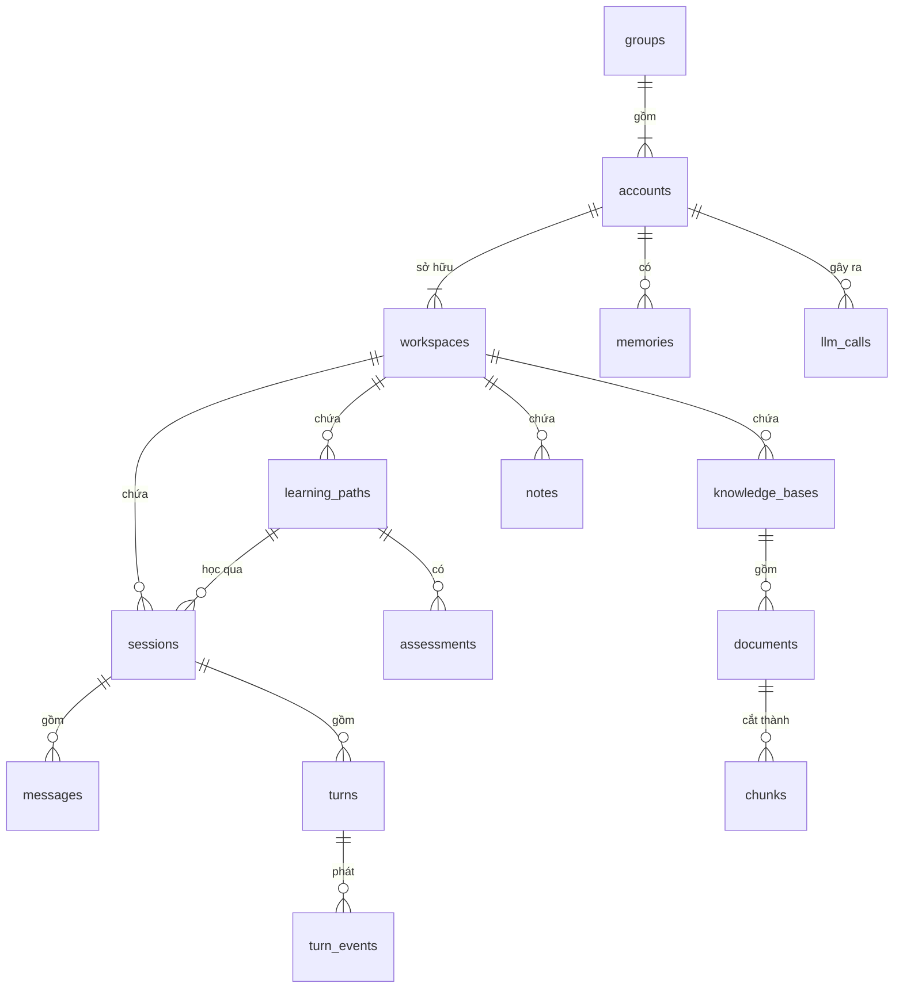

# Thiết kế cơ sở dữ liệu

Bản thiết kế lưu trữ cho bản chạy thật của Masterly, triển khai trên AWS. Đây là
nguyên liệu cho mục thiết kế cơ sở dữ liệu ở chương 3, và là căn cứ khi tạo bảng
cho từng chức năng.

Liên quan đặc tả: mục 2.2.1 (tác nhân Chủ nhóm và Người học, nhóm tách biệt nhau),
mục 2.3 (dữ liệu mỗi người tách riêng; khóa truy cập không bao giờ hiển thị đầy đủ).

## 1. Tổng quan

| Dữ liệu | Khi phát triển | Trên AWS |
|---|---|---|
| Dữ liệu nghiệp vụ và vector tài liệu | PostgreSQL (pgvector) trong Docker | RDS PostgreSQL (pgvector) |
| Tệp: tài liệu gốc, ảnh đại diện, tệp đính kèm | Thư mục trên máy | S3 |
| Bí mật và cấu hình triển khai | Tệp `.env` | Secrets Manager, đưa vào biến môi trường |

Nguyên tắc:

- Một cơ sở dữ liệu chung; dữ liệu các nhóm và người dùng tách nhau bằng khóa ngoại.
- Mỗi thực thể một bảng. Phần chỉ đọc và ghi cả khối, không cần nối hay lọc, để
  trong cột `jsonb` của chính bảng đó, không tách bảng phụ.
- Mã định danh UUID; thời gian `timestamptz`.
- Xóa tài khoản thì xóa theo mọi dữ liệu của tài khoản (`ON DELETE CASCADE`).
- Khóa API và phiên ChatGPT được mã hóa trước khi lưu.
- Thay đổi cấu trúc bảng qua migration (Alembic); truy cập qua SQLAlchemy 2.

## 2. Sơ đồ thực thể – liên kết



14 bảng, chia ba vùng:

- Nhóm và tài khoản: `groups`, `accounts`.
- Theo tài khoản: `workspaces`, `memories`, `llm_calls`.
- Theo không gian học: trò chuyện (`sessions`, `messages`, `turns`, `turn_events`),
  lộ trình (`learning_paths`, `assessments`), tài liệu (`knowledge_bases`,
  `documents`, `chunks`), ghi chép (`notes`).

## 3. Các bảng

### 3.1. Nhóm và tài khoản

`groups`: một nhóm, lập khi chủ nhóm đăng ký; giữ luôn cấu hình dịch vụ của nhóm.

| Cột | Kiểu | Ý nghĩa |
|---|---|---|
| id | uuid, PK | |
| model_catalog | jsonb | Nhà cung cấp và mô hình của bốn dịch vụ (trả lời, việc nền, embedding, tìm kiếm); khóa API đã mã hóa |
| catalog_draft | jsonb | Bản nháp chưa áp dụng của trang cấu hình |
| codex_session | bytea | Phiên đăng nhập ChatGPT, đã mã hóa |
| created_at | timestamptz | |

`accounts`: mọi tài khoản, cả chủ nhóm và người học.

| Cột | Kiểu | Ý nghĩa |
|---|---|---|
| id | uuid, PK | |
| group_id | uuid, FK `groups` | Nhóm của tài khoản |
| role | text | `owner` hoặc `learner` |
| email | text, duy nhất | Dùng để đăng nhập |
| password_hash | text | Băm bằng bcrypt |
| display_name | text | |
| avatar | text | Rỗng, `icon:<name>:<color>` hoặc khóa tệp ảnh |
| theme, language | text | Cài đặt giao diện |
| disabled | bool | Khóa tài khoản |
| created_at | timestamptz | Ngày tham gia |

- Mỗi nhóm có đúng một `owner`: ràng buộc duy nhất trên `group_id` với điều kiện
  `role = 'owner'`.
- Đăng ký: tạo nhóm và tài khoản chủ nhóm trong cùng một giao dịch.

### 3.2. Theo tài khoản

`workspaces`: không gian học.

| Cột | Kiểu | Ý nghĩa |
|---|---|---|
| id | uuid, PK | |
| account_id | uuid, FK `accounts` | |
| name | text | |
| is_default | bool | Không gian mặc định, tạo cùng tài khoản |
| archived_at | timestamptz | Đã lưu trữ |
| created_at | timestamptz | |

`memories`: bộ nhớ người học, dùng chung cho mọi không gian.

| Cột | Kiểu | Ý nghĩa |
|---|---|---|
| account_id | uuid, PK, FK `accounts` | |
| slot | text, PK | Phần bộ nhớ: `profile`, `preferences`, `recent`, tóm tắt theo trò chuyện, theo lộ trình |
| content | text | Markdown; người học xem, sửa, xóa được |
| updated_at | timestamptz | |

`llm_calls`: chi phí mỗi lần gọi mô hình.

| Cột | Kiểu | Ý nghĩa |
|---|---|---|
| id | uuid, PK | |
| account_id | uuid, FK `accounts` | |
| turn_id | uuid | Lượt đã gọi |
| model | text | |
| usage | jsonb | Số token, chi phí ước tính |
| created_at | timestamptz | |

### 3.3. Trò chuyện

`sessions`: cuộc trò chuyện.

| Cột | Kiểu | Ý nghĩa |
|---|---|---|
| id | uuid, PK | |
| workspace_id | uuid, FK `workspaces` | |
| path_id | uuid, FK `learning_paths`, có thể trống | Lộ trình đang học trong cuộc trò chuyện này |
| title | text | |
| summary | jsonb | Tóm tắt phần đầu khi cuộc trò chuyện dài |
| preferences | jsonb | Chế độ, công cụ, kho tài liệu đang chọn |
| archived_at | timestamptz | |
| created_at, updated_at | timestamptz | |

`messages`: tin nhắn.

| Cột | Kiểu | Ý nghĩa |
|---|---|---|
| id | bigint, PK, tự tăng | |
| session_id | uuid, FK `sessions` | |
| parent_id | bigint, FK `messages` | Tin nhắn trước trên cùng nhánh (sửa tin nhắn thì rẽ nhánh) |
| role | text | `user` hoặc `assistant` |
| content | text | |
| extra | jsonb | Các bước hiển thị kèm, nguồn trích dẫn, tệp đính kèm |
| created_at | timestamptz | |

`turns`: một lượt hỏi đáp đang chạy hoặc đã xong.

| Cột | Kiểu | Ý nghĩa |
|---|---|---|
| id | uuid, PK | |
| session_id | uuid, FK `sessions` | |
| message_id | bigint, FK `messages` | Câu trả lời của lượt |
| status | text | `running`, `completed`, `failed`, `cancelled` |
| error | text | |
| created_at, finished_at | timestamptz | |

`turn_events`: sự kiện phát ra trong lượt, để phát lại khi tải lại trang hay mất kết
nối.

| Cột | Kiểu | Ý nghĩa |
|---|---|---|
| turn_id | uuid, PK, FK `turns` | |
| seq | int, PK | Thứ tự |
| type | text | |
| data | jsonb | |
| created_at | timestamptz | |

### 3.4. Lộ trình

`learning_paths`

| Cột | Kiểu | Ý nghĩa |
|---|---|---|
| id | uuid, PK | |
| workspace_id | uuid, FK `workspaces` | |
| goal | text | Mục tiêu học |
| status | text | `active` hoặc `archived` |
| state | jsonb | Học phần, điểm kiến thức, mức nắm vững, lịch ôn, câu hỏi đang chờ trả lời, nguồn của lộ trình |
| revision | int | Tăng mỗi lần ghi; chỉ ghi khi revision khớp, tránh hai lượt ghi đè nhau |
| created_at, updated_at | timestamptz | |

`assessments`: mỗi câu trả lời đã chấm là một dòng; là căn cứ để xét nắm vững và
xếp lịch ôn.

| Cột | Kiểu | Ý nghĩa |
|---|---|---|
| id | uuid, PK | |
| path_id | uuid, FK `learning_paths` | |
| knowledge_point_id | text | Điểm kiến thức (mã trong `state`) |
| session_id | uuid, FK `sessions`, có thể trống | |
| kind | text | `quiz`, `qualitative`, `review` |
| result | text | `correct`, `incorrect`, `partial` |
| question | jsonb | Câu hỏi, đáp án, câu trả lời của người học, nhận xét của AI |
| detail | jsonb | Số lần thử, số gợi ý, độ tự tin, thời gian trả lời |
| created_at | timestamptz | |

### 3.5. Tài liệu

`knowledge_bases`

| Cột | Kiểu | Ý nghĩa |
|---|---|---|
| id | uuid, PK | |
| workspace_id | uuid, FK `workspaces` | |
| name | text | |
| embedding_model | text | Mô hình và số chiều đã dùng; đổi mô hình thì biết phải xử lý lại |
| created_at | timestamptz | |

`documents`

| Cột | Kiểu | Ý nghĩa |
|---|---|---|
| id | uuid, PK | |
| kb_id | uuid, FK `knowledge_bases` | |
| folder | text | Đường dẫn thư mục trong kho, ví dụ `Chương 1/Bài đọc` |
| file_name | text | |
| storage_key | text | Khóa tệp gốc trên S3 (hoặc thư mục) |
| size_bytes | bigint | |
| status | text | `processing`, `ready`, `failed` |
| error | text | Lỗi xử lý, để thử lại |
| created_at | timestamptz | |

`chunks`: đoạn văn cắt từ tài liệu.

| Cột | Kiểu | Ý nghĩa |
|---|---|---|
| id | uuid, PK | |
| document_id | uuid, FK `documents` | |
| ordinal | int | Thứ tự trong tài liệu, để ghép lại toàn văn |
| content | text | |
| locator | jsonb | Trang, chương, mục |
| embedding | vector | Tìm theo nghĩa (chỉ mục HNSW) |
| search_text | tsvector | Tìm theo từ khóa (chỉ mục GIN), sinh từ `content` |

### 3.6. Ghi chép

`notes`

| Cột | Kiểu | Ý nghĩa |
|---|---|---|
| id | uuid, PK | |
| workspace_id | uuid, FK `workspaces` | |
| session_id | uuid, FK `sessions`, có thể trống | Cuộc trò chuyện đang mở khi ghi |
| title | text | |
| content | text | Markdown |
| created_at, updated_at | timestamptz | |

## 4. Lưu tệp

- Tệp tải lên đi qua backend: backend kiểm tra loại và kích thước, lưu bản gốc, ghi
  `documents` với trạng thái `processing` rồi trả lời ngay; việc xử lý chạy nền.
  Thử lại hoặc đổi mô hình embedding thì đọc lại bản gốc.
- Mã gọi một lớp lưu tệp chung, có hai cách lưu: thư mục khi phát triển, S3 khi
  triển khai. Khóa tệp giống nhau ở cả hai:

```text
<group_id>/<account_id>/avatar/<version>.<ext>
<group_id>/<account_id>/documents/<document_id>.<ext>
<group_id>/<account_id>/attachments/<file_id>.<ext>
```

## 5. Biến môi trường

| Biến | Ý nghĩa |
|---|---|
| `DATABASE_URL` | Kết nối PostgreSQL |
| `AUTH_SECRET` | Khóa ký phiên đăng nhập |
| `ENCRYPTION_KEY` | Khóa mã hóa khóa API và phiên ChatGPT |
| `STORAGE_BACKEND` | `local` hoặc `s3` |
| `STORAGE_LOCAL_DIR` / `S3_BUCKET` | Nơi lưu tệp |

## 6. Tạo bảng theo chức năng

| Chức năng | Bảng |
|---|---|
| F01 Đăng ký và đăng nhập | `groups`, `accounts`, `workspaces` |
| F03 Cấu hình dịch vụ bên ngoài | Dùng các cột cấu hình của `groups`; `llm_calls` |
| F04 Trò chuyện với AI | `sessions`, `messages`, `turns`, `turn_events` |
| F08, F09, F10, F11 Lộ trình, học, ôn, tiến độ | `learning_paths`, `assessments` |
| F07 Tải lên và sắp xếp tài liệu học | `knowledge_bases`, `documents`, `chunks` |
| F06 Điều chỉnh bộ nhớ người học | `memories` |
| F14 Ghi chép trong lúc học | `notes` |
| F02, F05 | Không thêm bảng |
