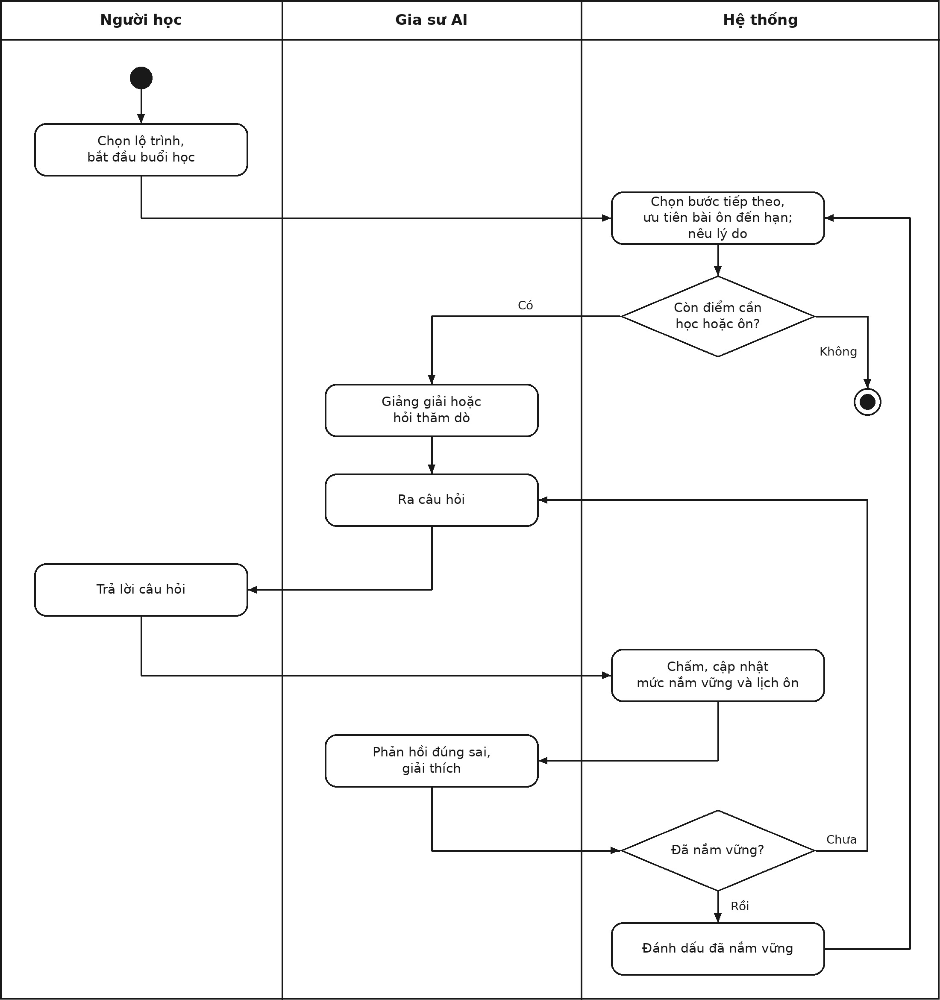
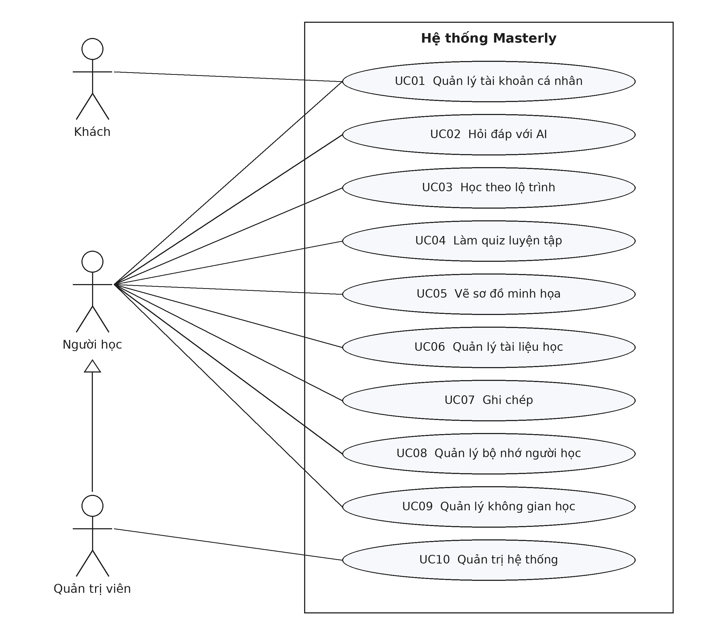
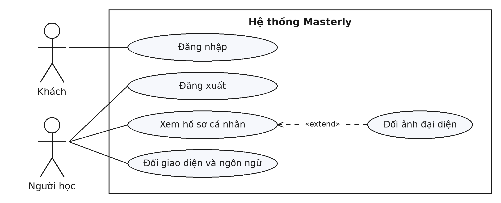
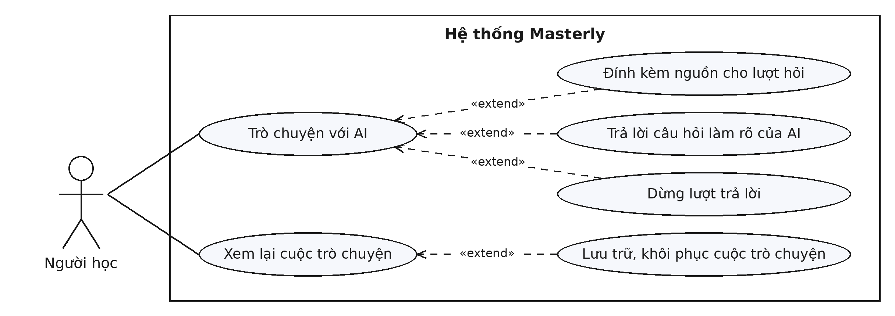
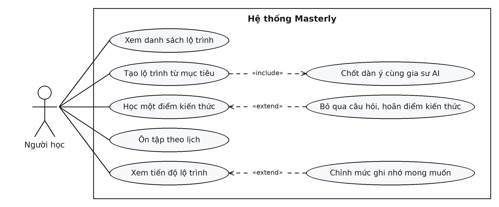
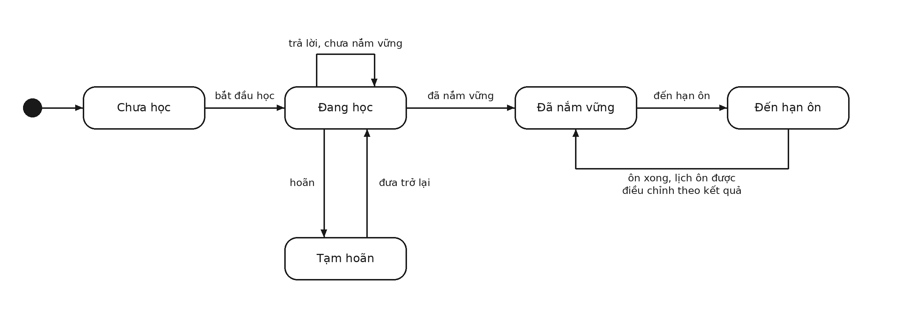
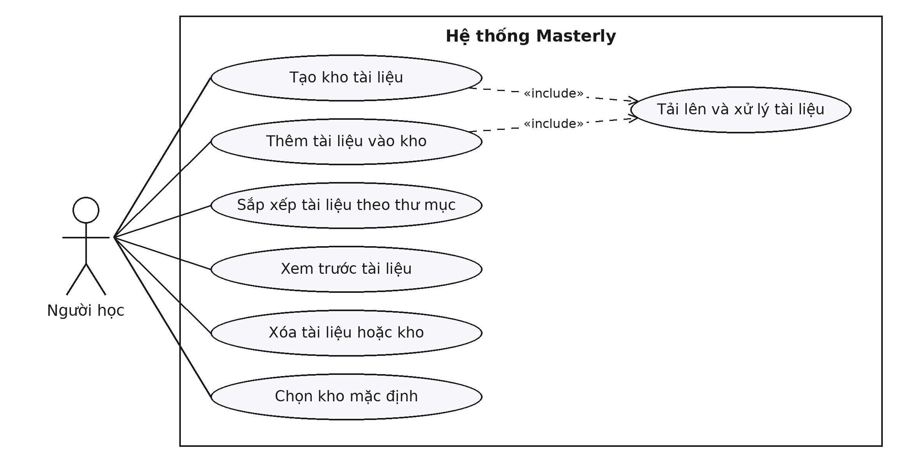
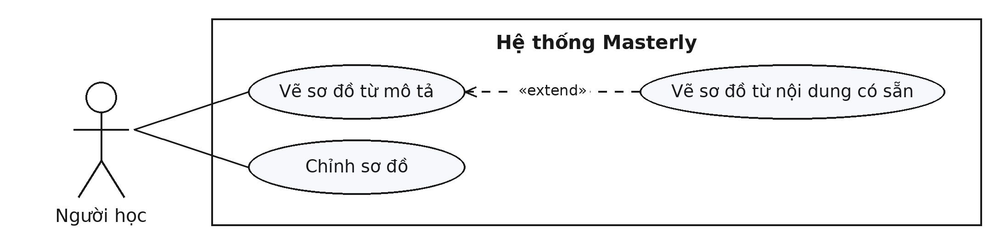
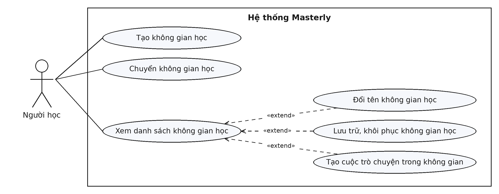
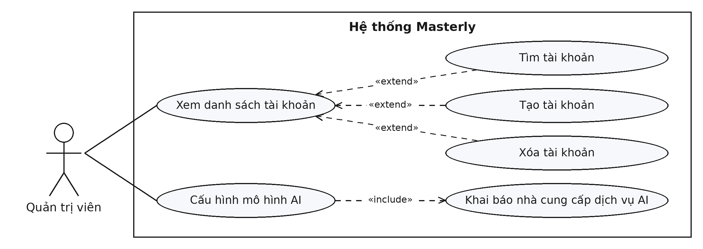

# Chương 2. Phân tích và đặc tả yêu cầu

Chương này trình bày bài toán và các yêu cầu đối với Masterly, không gian học tập AI cá nhân hóa có khả năng thích ứng theo tiến trình người học. Phần đầu khảo sát bài toán; phần tiếp theo xác định tác nhân, các ca sử dụng và đặc tả từng ca sử dụng; cuối chương là các yêu cầu phi chức năng. Chương chỉ nêu hệ thống phải làm được gì; cách thực hiện được trình bày ở chương thiết kế.

## 2.1. Khảo sát bài toán

### 2.1.1. Bối cảnh và phát biểu bài toán

Các mô hình ngôn ngữ lớn cho phép người học đặt câu hỏi bằng ngôn ngữ tự nhiên và nhận lời giải thích gần như tức thời. Tuy nhiên, khi dùng một trợ lý hỏi đáp thông thường để tự học, người học gặp ba hạn chế. Thứ nhất, trợ lý không theo dõi người học đã thật sự nắm được gì; đọc một lời giải thích trôi chảy dễ tạo cảm giác đã hiểu, dù người học chưa phải tự trả lời câu hỏi nào. Thứ hai, việc học không có cấu trúc: người học phải tự quyết định học gì trước, khi nào chuyển nội dung mới và khi nào cần ôn lại. Thứ ba, các hoạt động học bị tách rời: tài liệu, câu hỏi đã làm và ghi chú nằm ở nhiều nơi, nên kết quả của hoạt động này khó được dùng lại cho hoạt động khác.

Bài toán đặt ra là xây dựng một ứng dụng web cho sinh viên và người tự học, đáp ứng ba yêu cầu:

- **Học có kiểm chứng.** Với một mục tiêu học, hệ thống chia nội dung thành các điểm kiến thức, dẫn dắt người học qua từng điểm, đặt câu hỏi, chấm câu trả lời và theo dõi mức nắm vững của từng điểm. Người học chỉ chuyển sang điểm tiếp theo khi đã nắm vững điểm hiện tại, và các điểm đã học được đưa vào lịch ôn tập.
- **Nhiều hoạt động học trên cùng một không gian.** Bên cạnh lộ trình, người học có thể hỏi đáp với AI trên tài liệu của mình và ghi chép trong lúc học, có AI ghi chép giúp. Kết quả của mỗi hoạt động được lưu lại và dùng lại làm nguồn cho hoạt động khác.
- **Cá nhân hóa qua nhiều buổi học.** Hệ thống ghi nhớ thông tin về người học qua các buổi học để AI điều chỉnh cách hỗ trợ cho phù hợp với từng người.

Điểm cốt lõi của bài toán là tách hai vai trò: AI đảm nhận việc giảng giải và đặt câu hỏi, còn việc người học đã nắm vững hay chưa và bước học tiếp theo là gì do hệ thống quyết định theo quy tắc nhất quán, dựa trên kết quả làm bài thực tế.

### 2.1.2. Quy trình học trên hệ thống

Quy trình trọng tâm của hệ thống là học theo lộ trình, gồm năm bước:

1. **Nêu mục tiêu.** Người học mô tả điều muốn học, có thể chọn thêm tài liệu của mình làm nguồn.
2. **Chốt dàn ý.** Gia sư AI hỏi về kiến thức đã có, mức độ muốn đạt và quỹ thời gian, rồi đề xuất dàn ý gồm các điểm kiến thức. Người học chỉnh sửa và chốt dàn ý.
3. **Học và làm bài.** Với mỗi điểm kiến thức, gia sư giảng giải hoặc hỏi thăm dò, sau đó ra câu hỏi. Người học trả lời, hệ thống chấm và cập nhật mức nắm vững.
4. **Qua điểm kiến thức.** Khi người học đã nắm vững, hệ thống chuyển sang điểm tiếp theo; nếu chưa, người học tiếp tục luyện điểm đó.
5. **Ôn tập.** Mỗi điểm đã học có lịch ôn riêng; khi đến hạn, bài ôn được ưu tiên trước nội dung mới.

Hình 2.1 thể hiện một buổi học theo lộ trình, chia theo ba bên tham gia. Gia sư AI giảng giải, ra câu hỏi và phản hồi; hệ thống chọn bước tiếp theo, chấm câu trả lời và quyết định người học đã nắm vững hay chưa.

**Hình 2.1. Biểu đồ hoạt động của một buổi học theo lộ trình**

Bên cạnh quy trình này, người học hỏi đáp tự do với AI khi cần và ghi chép trong lúc học; AI có thể ghi chép giúp khi người học yêu cầu. Ghi chép được dùng lại làm nguồn cho các lần học sau. Toàn bộ nội dung được tổ chức theo không gian học, ví dụ mỗi môn học một không gian.

### 2.1.3. Phạm vi hệ thống

Hệ thống là một ứng dụng web, mỗi người dùng có tài khoản và dữ liệu riêng. Việc sinh câu trả lời, xử lý tài liệu để tra cứu và tìm kiếm trên web do các dịch vụ AI bên ngoài đảm nhận; hệ thống không tự huấn luyện hay vận hành mô hình ngôn ngữ.

Các nội dung sau nằm ngoài phạm vi: học qua video và âm thanh, sinh ảnh và video, tương tác bằng giọng nói, sách do AI viết, ứng dụng di động, tổ chức và lớp học, phân quyền nhiều cấp.

Hình 2.2 cho thấy các khối chức năng trong phạm vi hệ thống và liên kết giữa chúng: học theo lộ trình là phần lõi; trong mỗi không gian học, kho tài liệu là nguồn tra cứu cho cả hỏi đáp và lộ trình, người học ghi chép trong buổi học và ghi chép lại là nguồn tra cứu cho lộ trình; bộ nhớ người học dùng chung cho mọi không gian học, nhận dữ liệu học tập và quay lại cá nhân hóa câu trả lời của AI; phần nền gồm tài khoản, quản trị và các dịch vụ AI bên ngoài.

**Hình 2.2. Sơ đồ tổng quan các khối chức năng của hệ thống**

## 2.2. Yêu cầu chức năng

### 2.2.1. Xác định các tác nhân

Hệ thống có ba tác nhân, đều là người dùng (Bảng 2.1). Các dịch vụ AI và dịch vụ tìm kiếm web mà hệ thống kết nối tới là thành phần bên ngoài, không phải tác nhân.

**Bảng 2.1. Danh sách các tác nhân của hệ thống**

| STT | Tác nhân | Mô tả |
|---|---|---|
| 1 | Khách | Người chưa đăng nhập. Khách chỉ đăng nhập được bằng tài khoản đã được cấp. |
| 2 | Người học | Người đã đăng nhập, sử dụng toàn bộ chức năng học tập, ghi chép và cá nhân hóa trên dữ liệu của riêng mình. |
| 3 | Quản trị viên | Người học có thêm quyền tạo, xóa tài khoản và cấu hình mô hình AI dùng chung. Hệ thống chỉ có một quản trị viên. |

### 2.2.2. Biểu đồ ca sử dụng tổng quát

Hình 2.3 mô tả quan hệ giữa các tác nhân và chức năng của hệ thống. Khách tham gia ca sử dụng quản lý tài khoản cá nhân; người học tham gia bảy ca sử dụng đầu; quản trị viên có toàn bộ ca sử dụng của người học và có thêm ca sử dụng quản trị hệ thống. Danh sách ca sử dụng được thống kê trong Bảng 2.2.

**Hình 2.3. Biểu đồ ca sử dụng tổng quát của hệ thống Masterly**

**Bảng 2.2. Danh sách các ca sử dụng của hệ thống**

| Mã | Tên ca sử dụng | Tác nhân |
|---|---|---|
| UC01 | Quản lý tài khoản cá nhân | Khách, Người học |
| UC02 | Hỏi đáp với AI | Người học |
| UC03 | Học theo lộ trình | Người học |
| UC04 | Quản lý tài liệu học | Người học |
| UC05 | Ghi chép | Người học |
| UC06 | Quản lý bộ nhớ người học | Người học |
| UC07 | Quản lý không gian học | Người học |
| UC08 | Quản trị hệ thống | Quản trị viên |

### 2.2.3. Đặc tả các ca sử dụng

Mỗi ca sử dụng có một biểu đồ ca sử dụng phân rã thể hiện các ca sử dụng con. Tác nhân nối trực tiếp với những ca sử dụng con mà tác nhân tự bắt đầu; quan hệ «include» chỉ ca sử dụng con luôn được thực hiện cùng ca sử dụng chính, quan hệ «extend» chỉ ca sử dụng con tùy chọn, chỉ xảy ra bên trong ca sử dụng chính. Hai ca sử dụng thuộc phần học chính (UC02, UC03) được đặc tả đầy đủ với luồng cơ bản, luồng thay thế và quy tắc; các ca sử dụng còn lại được đặc tả gọn qua mô tả, các chức năng và quy tắc. Những điều kiện sau áp dụng chung cho mọi ca sử dụng, trừ UC01:

- **Tiền điều kiện chung.** Người dùng đã đăng nhập; với các chức năng có dùng AI, quản trị viên đã cấu hình mô hình AI.
- **Ngoại lệ chung.** Khi dịch vụ AI lỗi hoặc quá thời gian, hệ thống thông báo lỗi, giữ nguyên dữ liệu đã có và cho phép thử lại.
- **Phạm vi dữ liệu.** Nội dung được tạo ra thuộc về người dùng đã tạo nó và thuộc không gian học đang mở lúc tạo.

#### UC01: Quản lý tài khoản cá nhân

**Tác nhân:** Khách, Người học.

**Mô tả:** Người dùng đăng nhập để dùng hệ thống trên dữ liệu của riêng mình và quản lý các thông tin cá nhân. Các ca sử dụng con được thể hiện ở Hình 2.4.

**Hình 2.4. Biểu đồ ca sử dụng phân rã – Quản lý tài khoản cá nhân**

**Chức năng:**

- **Đăng nhập.** Người dùng đăng nhập bằng tên đăng nhập và mật khẩu; sau khi đăng nhập chỉ thấy dữ liệu của mình.
- **Đăng xuất.** Kết thúc phiên đăng nhập trên thiết bị đang dùng.
- **Xem hồ sơ cá nhân.** Người học xem tên, vai trò, ngày tham gia; từ đây có thể đổi ảnh đại diện.
- **Đổi giao diện và ngôn ngữ.** Người học chọn giao diện sáng hoặc tối và ngôn ngữ hiển thị; lựa chọn được áp dụng ngay.

**Quy tắc:**

- Mật khẩu có ít nhất 8 ký tự. Sai tên đăng nhập hoặc mật khẩu thì không đăng nhập được.
- Hệ thống không có chức năng tự đăng ký. Tài khoản quản trị viên được khai báo sẵn khi cài đặt hệ thống; mọi tài khoản khác do quản trị viên tạo (UC08).
- Phiên đăng nhập có thời hạn; hết hạn thì người dùng phải đăng nhập lại.

#### UC02: Hỏi đáp với AI

**Tác nhân:** Người học.

**Mô tả:** Người học trò chuyện nhiều lượt với AI để tìm hiểu kiến thức. AI trả lời dựa trên cuộc trò chuyện và các nguồn được đính kèm, tự tra cứu tài liệu của người học hoặc tìm kiếm trên web khi cần. Các ca sử dụng con được thể hiện ở Hình 2.5.

**Hình 2.5. Biểu đồ ca sử dụng phân rã – Hỏi đáp với AI**

**Hậu điều kiện:** Câu hỏi và câu trả lời được lưu trong cuộc trò chuyện; người học mở lại được để xem hoặc hỏi tiếp.

**Bảng 2.3. Luồng cơ bản – Trò chuyện với AI**

| Hành động của người học | Phản ứng của hệ thống |
|---|---|
| 1. Mở trang trò chuyện, nhập câu hỏi và gửi. | 2. Lưu câu hỏi vào cuộc trò chuyện, tạo cuộc trò chuyện mới nếu chưa có. |
| | 3. AI soạn câu trả lời dựa trên cuộc trò chuyện và các nguồn được đính kèm; khi cần, AI tra cứu tài liệu của người học hoặc tìm kiếm trên web. |
| | 4. Hiển thị dần câu trả lời ngay khi được sinh ra, kèm các nguồn đã dùng. |
| | 5. Lưu câu trả lời vào cuộc trò chuyện. |
| 6. Đọc câu trả lời và hỏi tiếp. | 7. Lặp lại từ bước 2. |

**Luồng thay thế:**

- **Đính kèm nguồn.** Trước khi gửi, người học chọn nguồn cho lượt hỏi: tài liệu (kho tài liệu, tệp) hoặc kết quả học cũ (cuộc trò chuyện cũ, ghi chép). AI dựa vào các nguồn này khi trả lời.
- **AI hỏi lại để làm rõ.** Khi yêu cầu chưa rõ, AI dừng lại và hỏi người học, mỗi câu hỏi có sẵn các lựa chọn để bấm; sau khi người học trả lời, AI trả lời tiếp.
- **Dừng lượt trả lời.** Trong lúc câu trả lời đang hiện, người học chọn dừng; hệ thống ngừng lượt đó và giữ phần đã hiển thị.
- **Xem lại cuộc trò chuyện.** Người học mở danh sách cuộc trò chuyện của không gian học đang mở để xem lại hoặc hỏi tiếp.
- **Lưu trữ, khôi phục cuộc trò chuyện.** Từ danh sách, người học lưu trữ cuộc trò chuyện không còn dùng và khôi phục khi cần.

**Luồng ngoại lệ:**

- **Tải lại trang giữa chừng.** Hệ thống hiển thị lại phần câu trả lời đã có và tiếp tục hiển thị phần còn lại.
- **Không tra cứu được nguồn.** AI vẫn trả lời bằng thông tin đang có; lượt trả lời không bị hủy.

**Quy tắc:**

- Câu trả lời phải hiển thị dần, không chờ sinh xong toàn bộ.
- AI dùng bộ nhớ về người học (UC06) để điều chỉnh câu trả lời cho phù hợp.

#### UC03: Học theo lộ trình

**Tác nhân:** Người học.

**Mô tả:** Người học học một chủ đề theo lộ trình gồm các điểm kiến thức. Gia sư AI dẫn dắt từng điểm, ra câu hỏi và phản hồi; hệ thống chấm câu trả lời, theo dõi mức nắm vững, quyết định bước tiếp theo và lập lịch ôn tập. Đây là ca sử dụng trọng tâm của hệ thống. Các ca sử dụng con được thể hiện ở Hình 2.6.

**Hình 2.6. Biểu đồ ca sử dụng phân rã – Học theo lộ trình**

**Hậu điều kiện:** Mỗi lần làm bài được lưu kèm kết quả chấm; mức nắm vững và lịch ôn được cập nhật; lần học sau tiếp tục đúng từ chỗ đã dừng.

**Bảng 2.4. Luồng cơ bản – Tạo lộ trình và chốt dàn ý**

| Hành động của người học | Phản ứng của hệ thống |
|---|---|
| 1. Mở danh sách lộ trình, chọn tạo lộ trình mới, nhập mục tiêu học và chọn tài liệu làm nguồn nếu muốn (kho tài liệu, ghi chép, cuộc trò chuyện cũ). | 2. Tạo lộ trình và mở buổi lập dàn ý với gia sư AI. |
| | 3. Gia sư hỏi về kiến thức đã có, mức độ muốn đạt, quỹ thời gian và cách học ưa thích. |
| 4. Trả lời các câu hỏi của gia sư. | 5. Gia sư đề xuất dàn ý gồm các phần và các điểm kiến thức. |
| 6. Yêu cầu chỉnh sửa cho tới khi đồng ý, rồi chốt dàn ý. | 7. Lưu dàn ý và chuyển lộ trình sang trạng thái học. |

**Bảng 2.5. Luồng cơ bản – Học một điểm kiến thức**

| Hành động của người học | Phản ứng của hệ thống |
|---|---|
| 1. Chọn một lộ trình và bắt đầu hoặc tiếp tục buổi học. | 2. Chọn bước tiếp theo: bài ôn đến hạn, hoặc điểm kiến thức chưa nắm vững kế tiếp trong dàn ý; cho biết lý do chọn. |
| | 3. Gia sư giảng giải hoặc hỏi thăm dò về điểm kiến thức đó. |
| | 4. Gia sư ra một câu hỏi. |
| 5. Trả lời câu hỏi. | 6. Chấm câu trả lời, lưu lần làm bài, cập nhật mức nắm vững và lịch ôn của điểm kiến thức. |
| | 7. Gia sư phản hồi đúng hay sai, kèm giải thích. |
| | 8. Nếu người học đã nắm vững, đánh dấu điểm kiến thức và chuyển sang bước tiếp theo; nếu chưa, quay lại bước 4. |

**Luồng thay thế:**

- **Tự giải thích lại.** Với những điểm kiến thức cần hiểu sâu hơn là ghi nhớ, gia sư yêu cầu người học giải thích lại bằng lời của mình và đánh giá phần giải thích đó; kết quả được ghi nhận làm căn cứ xét nắm vững.
- **Ôn tập theo lịch.** Trong buổi học, điểm kiến thức đến hạn ôn được đưa lên trước nội dung mới. Người học cũng có thể chủ động mở một buổi ôn từ kế hoạch ôn của lộ trình; trong buổi ôn, gia sư chỉ kiểm tra lại những điểm đã nắm vững, không dạy điểm mới.
- **Bỏ qua câu hỏi, hoãn điểm kiến thức.** Người học bỏ qua câu hỏi đang chờ, hoặc hoãn một điểm để học điểm khác trước; điểm bị hoãn chưa được tính là đã nắm vững và được đưa trở lại sau.
- **Xem tiến độ.** Người học xem bản đồ lộ trình: các phần, các điểm kiến thức, trạng thái từng điểm (chưa học, đang học, đã nắm vững) và kế hoạch ôn với ngày đến hạn của từng điểm.
- **Chỉnh mức ghi nhớ mong muốn.** Trên trang tiến độ, người học chọn mức ghi nhớ mong muốn của lộ trình; mức càng cao thì lịch ôn càng dày.
- **Rời hoặc chuyển lộ trình.** Trạng thái học được lưu để lần sau tiếp tục.

**Luồng ngoại lệ:**

- **Câu hỏi hoặc đáp án mẫu bị sai.** Gia sư sửa lại câu hỏi; lần làm bài với câu hỏi sai không được tính vào mức nắm vững và lịch ôn.

**Trạng thái của điểm kiến thức:** Hình 2.7 thể hiện các trạng thái một điểm kiến thức trải qua trong lộ trình. Điểm kiến thức chỉ chuyển sang đã nắm vững khi hệ thống xét đạt; sau đó điểm này quay lại mỗi khi đến hạn ôn.

**Hình 2.7. Biểu đồ trạng thái của một điểm kiến thức**

**Quy tắc:**

- Việc chấm bài, xét nắm vững và chọn bước tiếp theo do hệ thống quyết định theo quy tắc nhất quán; gia sư AI không tự quyết định người học đã qua hay chưa.
- Một lần trả lời đúng chưa đủ để coi là nắm vững; người học phải trả lời đúng ổn định qua nhiều lần.
- Chỉ câu trả lời của người học trong lộ trình mới làm thay đổi mức nắm vững; việc AI giảng giải (kể cả sơ đồ minh họa trong lời giảng) hay trả lời câu hỏi không làm thay đổi.
- Mỗi điểm kiến thức có lịch ôn riêng: ôn tốt thì lần ôn sau giãn ra, ôn kém thì gần lại.
- Bước tiếp theo luôn kèm lý do, ví dụ "ôn điểm này vì đã đến hạn".
- Câu trắc nghiệm được xáo thứ tự đáp án giữa các lần hỏi.

#### UC04: Quản lý tài liệu học

**Tác nhân:** Người học.

**Mô tả:** Người học tạo các kho tài liệu và tải tài liệu của mình lên, để AI tra cứu và dẫn nguồn khi trả lời ở các ca sử dụng khác. Các ca sử dụng con được thể hiện ở Hình 2.8.

**Hình 2.8. Biểu đồ ca sử dụng phân rã – Quản lý tài liệu học**

**Chức năng:**

- **Tạo kho tài liệu.** Người học đặt tên kho và chọn các tài liệu ban đầu.
- **Thêm tài liệu vào kho.** Tải thêm tài liệu vào một kho đã có.
- **Tải lên và xử lý tài liệu.** Được thực hiện mỗi khi tạo kho hoặc thêm tài liệu: hệ thống nhận tệp, xử lý để tra cứu và hiển thị tiến độ cho tới khi tài liệu sẵn sàng.
- **Sắp xếp tài liệu theo thư mục.** Tạo thư mục và chuyển tài liệu giữa các thư mục.
- **Xem trước tài liệu.** Xem danh sách tài liệu trong kho và xem trước nội dung một tài liệu.
- **Xóa tài liệu hoặc kho.**
- **Chọn kho mặc định** để AI tra cứu.

**Quy tắc:**

- Tài liệu xử lý thất bại được đánh dấu lỗi và cho phép thử lại.

#### UC05: Ghi chép

**Tác nhân:** Người học.

**Mô tả:** Người học ghi chép trong quá trình học; AI ghi chép giúp và chỉnh sửa ghi chép theo yêu cầu của người học. Các ghi chép tạo thành sổ ghi chép của người học để xem lại và dùng lại làm nguồn. Các ca sử dụng con được thể hiện ở Hình 2.9.

**Hình 2.9. Biểu đồ ca sử dụng phân rã – Ghi chép**

**Chức năng:**

- **Ghi chép trong lúc học.** Trong lúc hỏi đáp hoặc học theo lộ trình, người học mở phần ghi chép, tự viết nội dung dạng Markdown và xem trước.
- **Nhờ AI ghi chép.** Trong cuộc trò chuyện hoặc buổi học, người học bảo AI ghi lại một ý hoặc tóm tắt một phần vào ghi chép; AI viết ngắn gọn bằng lời của mình, không chép nguyên văn cuộc trò chuyện.
- **Nhờ AI chỉnh sửa ghi chép.** Người học bảo AI bổ sung, sửa hoặc sắp xếp lại ghi chép, hoặc chọn một đoạn và nhờ AI viết lại, rút gọn, mở rộng. AI cũng có thể đánh dấu các ý chính.
- **Quản lý sổ ghi chép.** Xem danh sách ghi chép, tìm, đổi tên và xóa ghi chép. Từ đây có thể xuất ghi chép ra tệp Markdown.
- **Dùng lại làm nguồn.** Đính kèm ghi chép vào lượt hỏi (UC02), hoặc chọn làm nguồn khi tạo lộ trình (UC03).

**Quy tắc:**

- AI chỉ ghi hoặc sửa ghi chép khi người học yêu cầu.
- Nội dung ghi chép không bị mất khi rời trang giữa chừng.

#### UC06: Quản lý bộ nhớ người học

**Tác nhân:** Người học.

**Mô tả:** Hệ thống tự ghi nhớ thông tin về người học qua các buổi học, như những gì đã học, mục tiêu và cách học ưa thích, để AI điều chỉnh cách hỗ trợ ở những lần sau. Người học kiểm soát được những gì hệ thống ghi nhớ. Các ca sử dụng con được thể hiện ở Hình 2.10.

**Hình 2.10. Biểu đồ ca sử dụng phân rã – Quản lý bộ nhớ người học**

**Chức năng:**

- **Xem bộ nhớ.** Người học xem những gì hệ thống đang ghi nhớ về mình và biết mỗi ghi nhận đến từ hoạt động nào.
- **Sửa, xóa ghi nhận.** Người học sửa hoặc xóa những ghi nhận chưa đúng.
- **Yêu cầu AI ghi nhớ hoặc quên.** Trong cuộc trò chuyện, người học bảo AI ghi nhớ một mong muốn, ví dụ "hãy giải thích bằng ví dụ", hoặc quên một điều đã ghi nhớ.
- **Bật, tắt bộ nhớ.** Khi bộ nhớ tắt, hệ thống không ghi nhớ thêm và AI không dùng bộ nhớ khi trả lời.

**Quy tắc:**

- Hệ thống tự cập nhật bộ nhớ sau các buổi học; người học không phải thao tác.
- Khi bộ nhớ đang bật, AI luôn dùng những thông tin chính về người học khi trả lời.
- Bộ nhớ dùng chung cho mọi không gian học của người học.
- Thông tin người học khai khi lập dàn ý một lộ trình (kiến thức đã có, mức độ muốn đạt, thời gian) thuộc về lộ trình đó (UC03).

#### UC07: Quản lý không gian học

**Tác nhân:** Người học.

**Mô tả:** Người học tạo các không gian học, ví dụ mỗi môn học một không gian, để cuộc trò chuyện, lộ trình, tài liệu và ghi chép của cùng một chủ đề nằm cùng nhau. Các ca sử dụng con được thể hiện ở Hình 2.11.

**Hình 2.11. Biểu đồ ca sử dụng phân rã – Quản lý không gian học**

**Chức năng:**

- **Tạo không gian học** bằng một tên, ví dụ "Xác suất thống kê"; hệ thống chuyển người học vào không gian vừa tạo.
- **Chuyển không gian học** để xem và làm việc với nội dung của không gian khác.
- **Xem danh sách không gian học** trên trang quản lý không gian học. Từ đây người học đổi tên một không gian; lưu trữ và khôi phục một không gian, nội dung của không gian được lưu trữ vẫn giữ nguyên; hoặc tạo cuộc trò chuyện mới gắn với một không gian đã chọn.

**Quy tắc:**

- Nội dung được tạo ở không gian nào thì thuộc không gian đó; khi không chọn, nội dung thuộc không gian mặc định.
- Một cuộc trò chuyện đã có tin nhắn thì không đổi sang không gian khác.
- Các trang xem lại (sổ ghi chép, lịch sử trò chuyện) luôn cho biết đang hiển thị nội dung của không gian nào.
- Tên không gian không được để trống.

#### UC08: Quản trị hệ thống

**Tác nhân:** Quản trị viên.

**Mô tả:** Quản trị viên tạo, xóa tài khoản cho người dùng khác và cấu hình mô hình AI dùng chung cho cả hệ thống. Các ca sử dụng con được thể hiện ở Hình 2.12.

**Hình 2.12. Biểu đồ ca sử dụng phân rã – Quản trị hệ thống**

**Chức năng:**

- **Xem danh sách tài khoản** (tên, vai trò, ngày tham gia). Từ danh sách, quản trị viên tìm tài khoản theo tên, tạo tài khoản mới bằng tên đăng nhập và mật khẩu ban đầu, hoặc xóa tài khoản sau khi xác nhận.
- **Cấu hình mô hình AI.** Luôn bắt đầu bằng việc khai báo nhà cung cấp dịch vụ AI và kiểm tra kết nối, rồi chọn mô hình cho ba dịch vụ: trả lời, xử lý tài liệu để tra cứu và tìm kiếm web. Cấu hình áp dụng cho mọi tài khoản.

**Quy tắc:**

- Tài khoản mới có dữ liệu riêng, đăng nhập được và dùng được ngay mô hình mặc định, không cần cấp quyền thêm.
- Tên đăng nhập không được trùng; mật khẩu ban đầu có ít nhất 8 ký tự.
- Hệ thống chỉ có một quản trị viên; không có chức năng nâng người học lên quản trị viên. Quản trị viên không xóa được tài khoản của chính mình.
- Người học không xem và không sửa được cấu hình mô hình AI.

## 2.3. Yêu cầu phi chức năng

- **Bảo mật và quyền riêng tư.** Mật khẩu không được lưu ở dạng đọc được. Dữ liệu của mỗi người dùng tách riêng; một người không xem hay sửa được dữ liệu của người khác. Khóa truy cập dịch vụ AI chỉ quản trị viên quản lý và không bao giờ hiển thị đầy đủ trên giao diện.
- **Tính nhất quán của việc đánh giá.** Với cùng một lịch sử làm bài, mức nắm vững, kết quả xét nắm vững, bước tiếp theo và lịch ôn luôn cho cùng một kết quả, không phụ thuộc vào câu trả lời của mô hình AI.
- **Độ tin cậy.** Nội dung đã sinh không bị mất khi tải lại trang giữa chừng. Lỗi ở một nguồn tra cứu không làm hỏng cả lượt trả lời. Tiến độ học được lưu sau mỗi lần làm bài.
- **Khả năng phản hồi.** Câu trả lời của AI được hiển thị dần ngay khi bắt đầu được sinh ra.
- **Khả năng thay thế thành phần.** Mô hình AI, dịch vụ xử lý tài liệu và dịch vụ tìm kiếm web được chọn qua cấu hình; đổi nhà cung cấp không cần sửa mã nguồn.
- **Tính dễ sử dụng.** Giao diện hỗ trợ tiếng Việt và tiếng Anh; ở mọi trang người học biết mình đang ở không gian học nào.
- **Triển khai.** Mọi người dùng đều phải đăng nhập. Tài khoản quản trị viên được khai báo sẵn trong cấu hình khi cài đặt hệ thống, để không ai khác giành được quyền quản trị; người dùng khác chỉ có tài khoản khi quản trị viên tạo.

## 2.4. Tổng kết chương

Chương này đã khảo sát bài toán xây dựng một không gian học tập AI cá nhân hóa, xác định ba tác nhân và đặc tả tám ca sử dụng, trong đó học theo lộ trình là ca sử dụng trọng tâm. Các yêu cầu phi chức năng về bảo mật, tính nhất quán của việc đánh giá, độ tin cậy và khả năng thay thế thành phần cũng đã được nêu. Chương tiếp theo trình bày thiết kế hệ thống đáp ứng các yêu cầu này.
