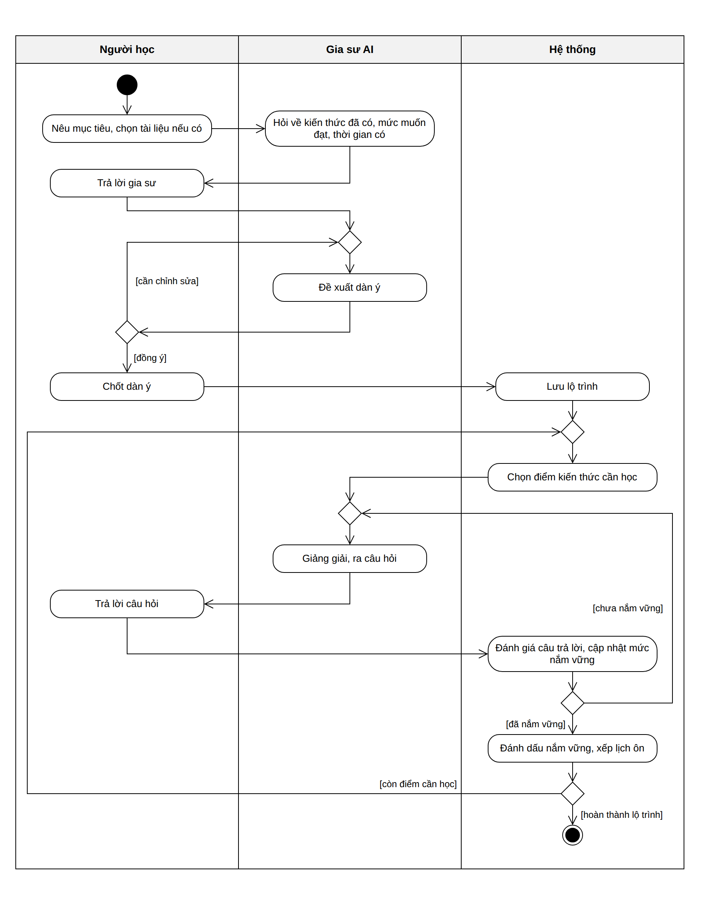
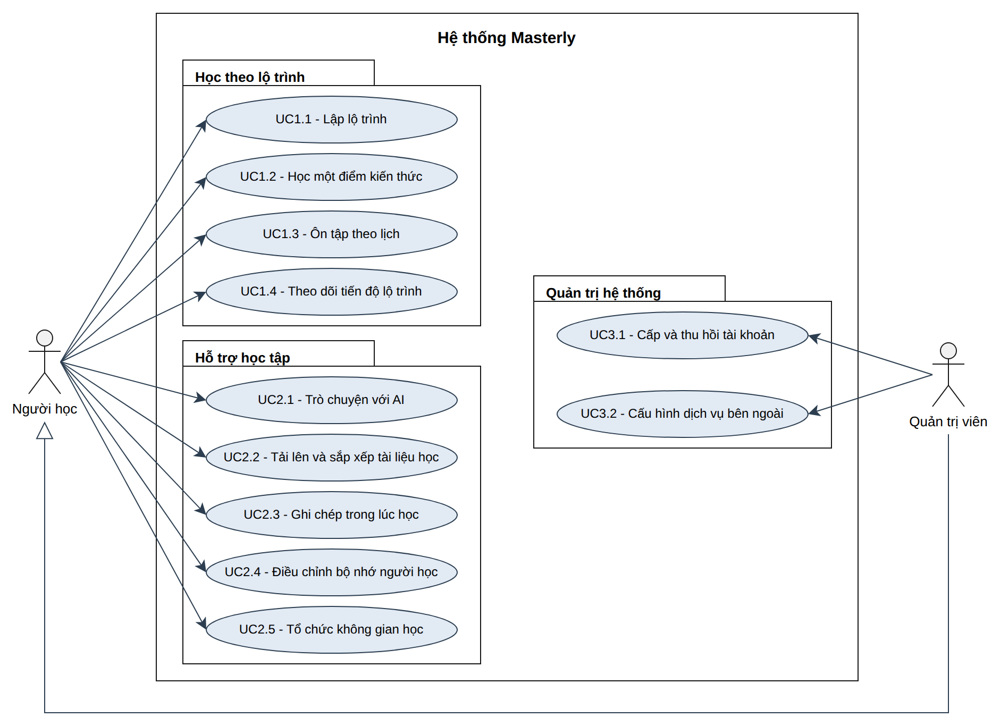
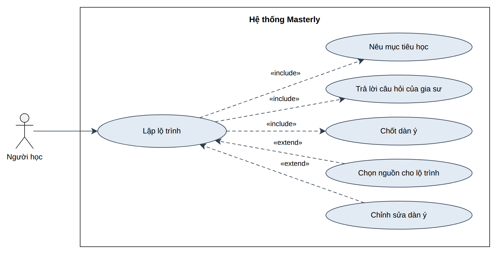
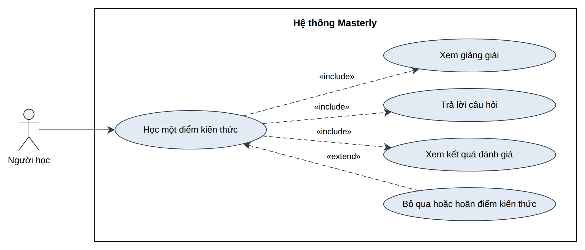
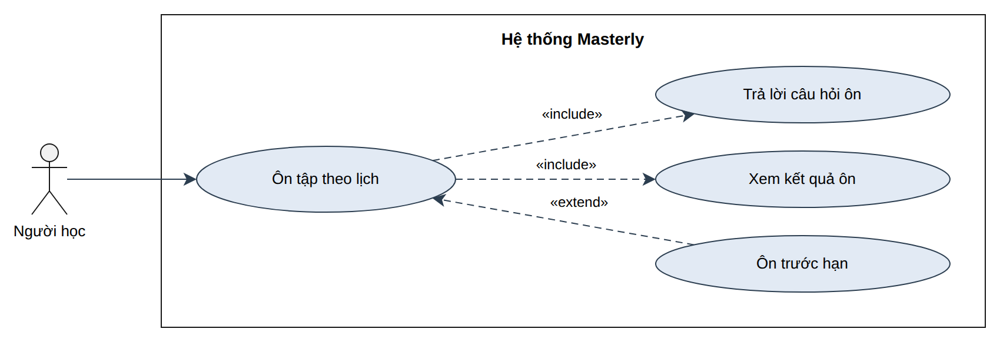
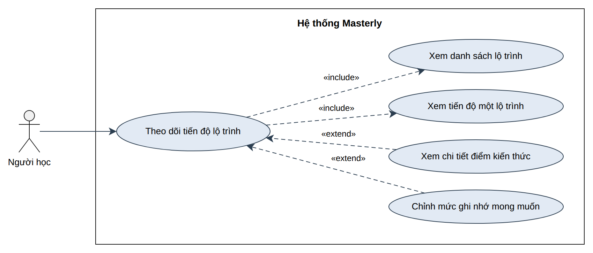
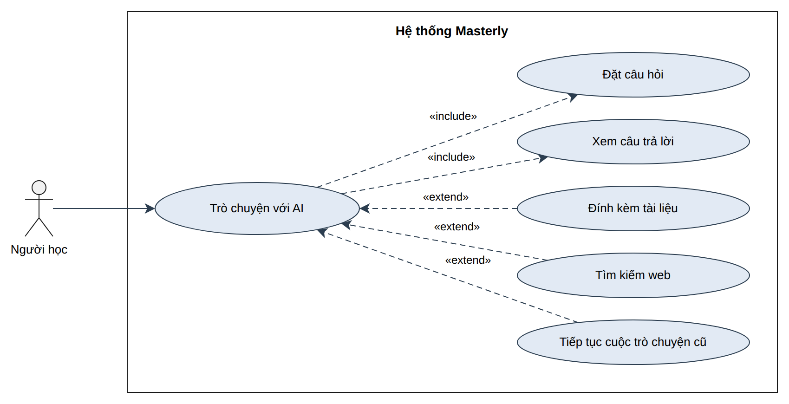
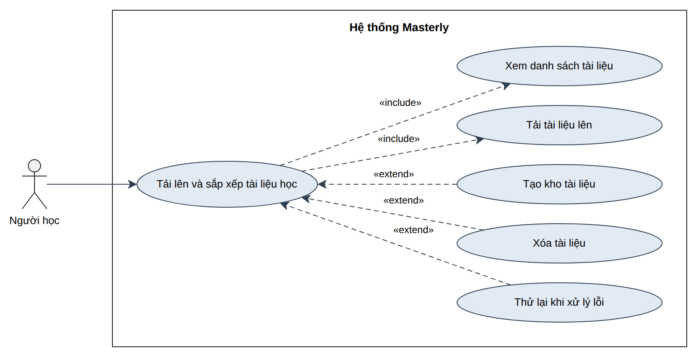
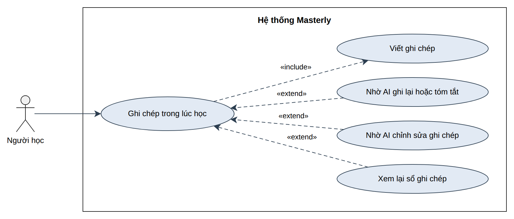
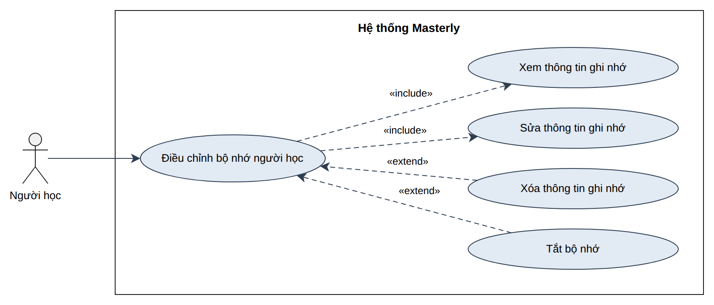

# Chương 2. Phân tích và đặc tả yêu cầu

Chương này trình bày bài toán và các yêu cầu đối với Masterly. Phần đầu khảo sát bài toán và các giải pháp đã có; phần tiếp theo xác định tác nhân và đặc tả các ca sử dụng; cuối chương là các yêu cầu phi chức năng.

## 2.1. Khảo sát bài toán

### 2.1.1. Bối cảnh và động lực

Ngày nay nhiều người tự học bằng AI: đưa tài liệu lên, đặt câu hỏi và nhận lời giải thích ngay. Cách học này còn hai hạn chế:

- Tưởng đã hiểu nhưng chưa nắm vững: đọc lời giải thích trôi chảy dễ tạo cảm giác đã hiểu, trong khi người học chưa tự trả lời câu hỏi nào.
- Học xong rồi quên: không có ai nhắc ôn lại đúng lúc.

Hai hạn chế này rõ nhất với những nội dung chưa có lộ trình soạn sẵn, như một môn chuyên ngành theo giáo trình riêng, một cuốn sách hay tài liệu nơi làm việc.

Vì vậy, người tự học cần một hệ thống không chỉ trả lời câu hỏi mà còn dẫn dắt, kiểm tra và nhắc ôn tập.

### 2.1.2. Phát biểu bài toán

Xây dựng một ứng dụng web giúp người học tự học có hệ thống theo mục tiêu của mình:

1. Từ mục tiêu của người học, kèm tài liệu nếu có, hệ thống lập lộ trình gồm các điểm kiến thức.
2. Với mỗi điểm kiến thức, AI giảng giải và đặt câu hỏi.
3. Hệ thống đánh giá câu trả lời và chỉ cho học tiếp khi người học đã nắm vững.
4. Các điểm đã học được xếp lịch ôn tập.

Yêu cầu cốt lõi: việc xét người học đã nắm vững hay chưa phải dựa trên kết quả làm bài thực tế, theo quy tắc nhất quán, không dựa vào cảm nhận của người học hay nhận xét của AI.

### 2.1.3. Các giải pháp tiêu biểu đã có

- NotebookLM (Google): hỏi đáp trên tài liệu tải lên, có dẫn nguồn; tạo tóm tắt, thẻ ghi nhớ và câu hỏi từ tài liệu.
- ChatGPT Study Mode (OpenAI), tương tự Guided Learning của Gemini và Learning mode của Claude: AI hướng dẫn từng bước, hỏi gợi mở thay vì đưa đáp án ngay.
- Khan Academy và Khanmigo: học đến khi thành thạo trên các bài học soạn sẵn, có gia sư AI dẫn dắt.
- Anki (mã nguồn mở): người học tự soạn thẻ ghi nhớ, mỗi thẻ có lịch ôn riêng.

**Bảng 2.1. So sánh các giải pháp tiêu biểu**

| Giải pháp | Học trên tài liệu, nội dung riêng | Lộ trình theo mục tiêu | Xét nắm vững | Ôn tập theo lịch |
|---|---|---|---|---|
| NotebookLM | Có | Không | Không | Không |
| ChatGPT Study Mode | Có | Không | Không | Không |
| Khan Academy và Khanmigo | Không | Soạn sẵn | Có | Không |
| Anki | Có | Không | Không | Có |
| Masterly | Có | Có | Có | Có |

Nhận xét:

- NotebookLM và ChatGPT Study Mode cho học trên tài liệu, nội dung riêng, nhưng không có lộ trình, không xét nắm vững và không nhắc ôn tập.
- Khan Academy xét nắm vững chặt chẽ, nhưng chỉ trên các bài học soạn sẵn.
- Anki xếp lịch ôn tốt, nhưng người học phải tự soạn thẻ và không có lộ trình hay người giảng.

Chưa có giải pháp nào có đủ cả bốn yếu tố trên.

### 2.1.4. Giải pháp đề xuất

Masterly là một vòng học khép kín: nêu mục tiêu, kèm tài liệu nếu có → lập lộ trình → học từng điểm kiến thức → kiểm tra nắm vững → ôn tập theo lịch.

Điểm khác biệt cốt lõi là tách hai vai trò:

- AI: lập lộ trình, giảng giải, đặt câu hỏi.
- Hệ thống: đánh giá câu trả lời, xét người học đã nắm vững hay chưa, chọn bước học tiếp theo và cho biết lý do.

Một lần trả lời đúng chưa đủ để coi là nắm vững; các điểm đã nắm vững vẫn được kiểm tra lại qua các lần ôn.

Ngoài vòng học chính, người học còn có thể:

- hỏi đáp tự do với AI trên tài liệu của mình;
- ghi chép trong lúc học;
- được hệ thống ghi nhớ thông tin qua các buổi học để AI hỗ trợ phù hợp hơn.

Mọi nội dung được tổ chức theo không gian học, ví dụ mỗi môn học một không gian.

Quy trình học theo lộ trình:

1. Nêu mục tiêu: người học mô tả điều muốn học và chọn tài liệu làm nguồn.
2. Chốt dàn ý: gia sư AI hỏi về kiến thức đã có, mức muốn đạt, thời gian có, rồi đề xuất dàn ý; người học chỉnh và chốt.
3. Học và làm bài: gia sư giảng giải rồi ra câu hỏi; hệ thống đánh giá và cập nhật mức nắm vững.
4. Qua điểm kiến thức: đã nắm vững thì chuyển sang điểm tiếp theo, chưa thì luyện tiếp.
5. Ôn tập: điểm đến hạn ôn được ưu tiên trước nội dung mới.

**Hình 2.1. Biểu đồ hoạt động của quy trình học theo lộ trình**

### 2.1.5. Phạm vi hệ thống

- Ứng dụng web, giao diện tiếng Việt và tiếng Anh.
- Mỗi người dùng có tài khoản và dữ liệu riêng; tài khoản do quản trị viên cấp, không có tự đăng ký.
- Việc sinh câu trả lời, xử lý tài liệu và tìm kiếm web dùng dịch vụ AI bên ngoài; hệ thống không tự huấn luyện mô hình.

## 2.2. Yêu cầu chức năng

### 2.2.1. Xác định các tác nhân

Hệ thống có hai tác nhân, đều là người dùng có tài khoản do quản trị viên cấp. Các dịch vụ bên ngoài mà hệ thống kết nối tới không phải tác nhân.

**Bảng 2.2. Danh sách các tác nhân của hệ thống**

| STT | Tác nhân | Mô tả |
|---|---|---|
| 1 | Người học | Người dùng các chức năng học tập trên dữ liệu của riêng mình. |
| 2 | Quản trị viên | Người học có thêm quyền quản lý tài khoản và cấu hình các dịch vụ bên ngoài dùng chung. Hệ thống có một quản trị viên. |

### 2.2.2. Biểu đồ ca sử dụng tổng quát

Các ca sử dụng được chia thành ba nhóm (Hình 2.2):

- Học theo lộ trình: phần lõi của hệ thống.
- Hỗ trợ học tập: các chức năng phục vụ việc học, gồm hỏi đáp, tài liệu, ghi chép, bộ nhớ và không gian học.
- Quản trị hệ thống: phần nền để hệ thống hoạt động.

Người học dùng các ca sử dụng của hai nhóm đầu. Quản trị viên có toàn bộ ca sử dụng của người học, thêm cấp và thu hồi tài khoản, cấu hình dịch vụ bên ngoài.

**Hình 2.2. Biểu đồ ca sử dụng tổng quát của hệ thống Masterly**

**Bảng 2.3. Danh sách các ca sử dụng của hệ thống**

| Nhóm | Mã | Tên ca sử dụng | Tác nhân |
|---|---|---|---|
| 1. Học theo lộ trình | UC1.1 | Lập lộ trình | Người học |
| | UC1.2 | Học một điểm kiến thức | Người học |
| | UC1.3 | Ôn tập theo lịch | Người học |
| | UC1.4 | Theo dõi tiến độ lộ trình | Người học |
| 2. Hỗ trợ học tập | UC2.1 | Trò chuyện với AI | Người học |
| | UC2.2 | Tải lên và sắp xếp tài liệu học | Người học |
| | UC2.3 | Ghi chép trong lúc học | Người học |
| | UC2.4 | Điều chỉnh bộ nhớ người học | Người học |
| | UC2.5 | Tổ chức không gian học | Người học |
| 3. Quản trị hệ thống | UC3.1 | Cấp và thu hồi tài khoản | Quản trị viên |
| | UC3.2 | Cấu hình dịch vụ bên ngoài | Quản trị viên |

### 2.2.3. Đặc tả các ca sử dụng

#### UC1.1 - Lập lộ trình

Tác nhân chính: Người học.

Mô tả tóm lược: Hình 2.3 mô tả ca sử dụng người học nêu mục tiêu học, trao đổi với gia sư AI và chốt dàn ý thành một lộ trình gồm các điểm kiến thức.

**Hình 2.3. Biểu đồ ca sử dụng UC1.1 - Lập lộ trình**

Luồng cơ bản: luồng bắt đầu khi người học chọn tạo lộ trình mới và kết thúc khi lộ trình được lưu.

**Bảng 2.4. Luồng cơ bản của UC1.1**

| Hành động của tác nhân | Phản ứng của hệ thống | Dữ liệu liên quan |
|---|---|---|
| 1. Chọn tạo lộ trình mới và nêu mục tiêu học. | 2. Gia sư AI hỏi về kiến thức đã có, mức muốn đạt và thời gian có. | Mục tiêu học |
| 3. Trả lời các câu hỏi của gia sư. | 4. Gia sư AI đề xuất dàn ý gồm các điểm kiến thức theo thứ tự học. | Kiến thức đã có, mức muốn đạt, thời gian có; dàn ý |
| 5. Đồng ý và chốt dàn ý. | 6. Lưu lộ trình và hiển thị lộ trình vừa tạo. | Lộ trình gồm các điểm kiến thức |

Luồng thay thế:

- Luồng thay thế 1 (Chọn nguồn cho lộ trình): tại bước 1, người học chọn thêm tài liệu, ghi chép hoặc cuộc trò chuyện cũ làm nguồn. Gia sư dựa vào các nguồn này khi hỏi và đề xuất dàn ý.
- Luồng thay thế 2 (Chỉnh sửa dàn ý): tại bước 5, người học yêu cầu thêm, bớt hoặc đổi thứ tự các điểm kiến thức. Hệ thống quay lại bước 4 với dàn ý đã chỉnh.

Tiền điều kiện: Người học đã đăng nhập.

Hậu điều kiện: Lộ trình được lưu trong không gian học hiện tại, sẵn sàng để học điểm kiến thức đầu tiên.

#### UC1.2 - Học một điểm kiến thức

Tác nhân chính: Người học.

Mô tả tóm lược: Hình 2.4 mô tả ca sử dụng người học học một điểm kiến thức trong lộ trình: gia sư AI giảng giải và đặt câu hỏi, hệ thống đánh giá câu trả lời và xét người học đã nắm vững hay chưa. Việc xét nắm vững dựa trên kết quả làm bài qua nhiều câu hỏi; một lần trả lời đúng chưa đủ để coi là nắm vững.

**Hình 2.4. Biểu đồ ca sử dụng UC1.2 - Học một điểm kiến thức**

Luồng cơ bản: luồng bắt đầu khi người học chốt xong dàn ý và bắt đầu học, hoặc tiếp tục một lộ trình đang học dở; kết thúc khi điểm kiến thức được đánh dấu đã nắm vững.

**Bảng 2.5. Luồng cơ bản của UC1.2**

| Hành động của tác nhân | Phản ứng của hệ thống | Dữ liệu liên quan |
|---|---|---|
| 1. Bắt đầu học sau khi chốt dàn ý, hoặc tiếp tục học ở lộ trình đang dở. | 2. Chọn điểm kiến thức cần học và cho biết lý do chọn. | Điểm kiến thức cần học |
| | 3. Gia sư AI giảng giải điểm kiến thức rồi đặt câu hỏi. | Câu hỏi |
| 4. Trả lời câu hỏi. | 5. Đánh giá câu trả lời, cho biết kết quả kèm giải thích và cập nhật mức nắm vững. | Câu trả lời, kết quả đánh giá, mức nắm vững |
| | 6. Nếu người học chưa nắm vững, quay lại bước 3: gia sư giảng thêm phần còn sai và đặt câu hỏi khác. | |
| | 7. Đánh dấu điểm kiến thức đã nắm vững và xếp lịch ôn. | Trạng thái nắm vững, lịch ôn |

Luồng thay thế:

- Luồng thay thế 1 (Bỏ qua hoặc hoãn điểm kiến thức): tại bước 2 hoặc 4, người học chọn bỏ qua hoặc hoãn điểm kiến thức đang học. Hệ thống chuyển sang điểm khác; điểm bị hoãn không được tính là nắm vững và được chọn lại khi các điểm khác đã học xong.

Tiền điều kiện: Người học đã đăng nhập và đã có lộ trình.

Hậu điều kiện: Kết quả làm bài và mức nắm vững của điểm kiến thức được lưu; điểm đã nắm vững được xếp lịch ôn.

#### UC1.3 - Ôn tập theo lịch

Tác nhân chính: Người học.

Mô tả tóm lược: Hình 2.5 mô tả ca sử dụng người học ôn lại các điểm kiến thức đã nắm vững khi đến hạn ôn. Điểm trả lời đúng được giãn lịch ôn, điểm trả lời sai được ôn lại sớm hơn.

**Hình 2.5. Biểu đồ ca sử dụng UC1.3 - Ôn tập theo lịch**

Luồng cơ bản: luồng bắt đầu khi người học chọn ôn tập lúc lộ trình có điểm đến hạn ôn và kết thúc khi đã ôn hết các điểm đến hạn.

**Bảng 2.6. Luồng cơ bản của UC1.3**

| Hành động của tác nhân | Phản ứng của hệ thống | Dữ liệu liên quan |
|---|---|---|
| 1. Chọn ôn tập khi lộ trình báo có điểm đến hạn ôn. | 2. Chọn điểm đến hạn cần ôn trước. | Các điểm đến hạn ôn |
| | 3. Gia sư AI đặt câu hỏi ôn về điểm kiến thức đó. | Câu hỏi |
| 4. Trả lời câu hỏi. | 5. Đánh giá câu trả lời, cho biết kết quả và cập nhật mức nắm vững cùng lịch ôn tiếp theo. | Câu trả lời, kết quả đánh giá, mức nắm vững, lịch ôn |
| | 6. Lặp lại bước 3–5 với các điểm đến hạn còn lại. | |
| | 7. Báo đã ôn xong và cho biết lần ôn tiếp theo. | |

Luồng thay thế:

- Luồng thay thế 1 (Ôn trước hạn): tại bước 1, người học xem kế hoạch ôn gồm các điểm đã nắm vững và thời điểm ôn tiếp theo, rồi chọn ôn một điểm chưa đến hạn. Hệ thống ôn điểm đó theo các bước 3–5.
- Luồng thay thế 2 (Ôn trong lúc học): khi người học đang học theo lộ trình (UC1.2) mà có điểm đến hạn ôn, hệ thống ưu tiên ôn điểm đó trước khi chuyển sang điểm kiến thức mới.

Tiền điều kiện: Người học đã đăng nhập và lộ trình có điểm kiến thức đã nắm vững.

Hậu điều kiện: Kết quả ôn được lưu; mức nắm vững và lịch ôn tiếp theo của các điểm đã ôn được cập nhật.

#### UC1.4 - Theo dõi tiến độ lộ trình

Tác nhân chính: Người học.

Mô tả tóm lược: Hình 2.6 mô tả ca sử dụng người học xem tiến độ của các lộ trình: điểm kiến thức nào đã nắm vững, nên học hoặc ôn gì tiếp theo và vì sao.

**Hình 2.6. Biểu đồ ca sử dụng UC1.4 - Theo dõi tiến độ lộ trình**

Luồng cơ bản: luồng bắt đầu khi người học mở danh sách lộ trình và kết thúc khi hệ thống hiển thị tiến độ của lộ trình được chọn.

**Bảng 2.7. Luồng cơ bản của UC1.4**

| Hành động của tác nhân | Phản ứng của hệ thống | Dữ liệu liên quan |
|---|---|---|
| 1. Mở danh sách lộ trình. | 2. Hiển thị các lộ trình, mỗi lộ trình kèm số điểm kiến thức đã nắm vững trên tổng số. | Danh sách lộ trình |
| 3. Chọn một lộ trình. | 4. Hiển thị các điểm kiến thức theo thứ tự học, mỗi điểm kèm trạng thái chưa học, đang học hoặc đã nắm vững. | Điểm kiến thức, trạng thái nắm vững |
| | 5. Cho biết việc nên làm tiếp theo kèm lý do: học điểm kiến thức nào hoặc ôn điểm nào. | Lịch ôn |

Luồng thay thế:

- Luồng thay thế 1 (Xem chi tiết điểm kiến thức): tại bước 4, người học chọn một điểm kiến thức. Hệ thống hiển thị kết quả các lần làm bài, mức nắm vững và lịch ôn của điểm đó.
- Luồng thay thế 2 (Chỉnh mức ghi nhớ mong muốn): tại bước 5, người học chọn mức ghi nhớ mong muốn cho lộ trình. Hệ thống lưu lại và xếp lại lịch ôn; mức càng cao thì lịch ôn càng dày.

Tiền điều kiện: Người học đã đăng nhập và đã có ít nhất một lộ trình.

Hậu điều kiện: Người học nắm được tiến độ của lộ trình; nếu đã chỉnh mức ghi nhớ mong muốn, lịch ôn được xếp lại theo mức mới.

#### UC2.1 - Trò chuyện với AI

Tác nhân chính: Người học.

Mô tả tóm lược: Hình 2.7 mô tả ca sử dụng người học hỏi đáp tự do với AI, có thể dựa trên tài liệu của mình hoặc thông tin trên web. Cuộc trò chuyện được lưu lại để xem và hỏi tiếp sau.

**Hình 2.7. Biểu đồ ca sử dụng UC2.1 - Trò chuyện với AI**

Luồng cơ bản: luồng bắt đầu khi người học tạo cuộc trò chuyện mới và kết thúc khi người học ngừng hỏi.

**Bảng 2.8. Luồng cơ bản của UC2.1**

| Hành động của tác nhân | Phản ứng của hệ thống | Dữ liệu liên quan |
|---|---|---|
| 1. Tạo cuộc trò chuyện mới và nhập câu hỏi. | 2. AI trả lời; câu trả lời hiện dần trên màn hình. | Câu hỏi, câu trả lời |
| 3. Hỏi tiếp. | 4. AI trả lời dựa trên nội dung đã trao đổi trong cuộc trò chuyện. | Câu hỏi, câu trả lời |
| | 5. Lưu cuộc trò chuyện vào không gian học hiện tại. | Cuộc trò chuyện |

Luồng thay thế:

- Luồng thay thế 1 (Đính kèm tài liệu): tại bước 1 hoặc 3, người học đính kèm tệp hoặc chọn một kho tài liệu đã tải lên (UC2.2). AI trả lời dựa trên tài liệu đó và dẫn nguồn đến phần nội dung đã dùng.
- Luồng thay thế 2 (Tìm kiếm web): tại bước 2 hoặc 4, khi câu hỏi cần thông tin không có trong cuộc trò chuyện hay tài liệu, AI tự tìm trên web và trả lời kèm đường dẫn nguồn.
- Luồng thay thế 3 (Tiếp tục cuộc trò chuyện cũ): tại bước 1, người học mở một cuộc trò chuyện trong lịch sử thay vì tạo mới. Hệ thống tải lại toàn bộ nội dung và người học hỏi tiếp từ đó.

Tiền điều kiện: Người học đã đăng nhập.

Hậu điều kiện: Cuộc trò chuyện được lưu trong không gian học hiện tại và có thể mở lại sau.

#### UC2.2 - Tải lên và sắp xếp tài liệu học

Tác nhân chính: Người học.

Mô tả tóm lược: Hình 2.8 mô tả ca sử dụng người học đưa tài liệu học của mình lên hệ thống và sắp xếp theo kho, để AI dùng khi trò chuyện (UC2.1) và khi lập lộ trình (UC1.1).

**Hình 2.8. Biểu đồ ca sử dụng UC2.2 - Tải lên và sắp xếp tài liệu học**

Luồng cơ bản: luồng bắt đầu khi người học mở một kho tài liệu và kết thúc khi tài liệu tải lên đã được xử lý xong.

**Bảng 2.9. Luồng cơ bản của UC2.2**

| Hành động của tác nhân | Phản ứng của hệ thống | Dữ liệu liên quan |
|---|---|---|
| 1. Mở một kho tài liệu; mỗi người học có sẵn một kho mặc định. | 2. Hiển thị các tài liệu trong kho, mỗi tài liệu kèm trạng thái xử lý. | Danh sách tài liệu |
| 3. Chọn tệp để tải lên. | 4. Tải tệp lên, xử lý nội dung và hiển thị tiến độ xử lý. | Tệp tài liệu, trạng thái xử lý |
| | 5. Báo tài liệu đã sẵn sàng để AI dùng. | Tài liệu đã xử lý |

Luồng thay thế:

- Luồng thay thế 1 (Tạo kho tài liệu): tại bước 1, người học tạo một kho mới, ví dụ mỗi môn học một kho. Hệ thống tạo kho trong không gian học hiện tại và mở kho đó.
- Luồng thay thế 2 (Xóa tài liệu): tại bước 2, người học chọn xóa một tài liệu và xác nhận. Hệ thống xóa tài liệu khỏi kho; AI không còn dùng tài liệu này khi trả lời.
- Luồng thay thế 3 (Thử lại khi xử lý lỗi): tại bước 4, nếu tài liệu không xử lý được, ví dụ tệp bị hỏng, hệ thống báo lỗi ở tài liệu đó. Người học chọn thử lại hoặc xóa tài liệu.

Tiền điều kiện: Người học đã đăng nhập.

Hậu điều kiện: Tài liệu được lưu trong kho và xử lý xong, sẵn sàng để AI dùng khi trò chuyện và khi lập lộ trình.

#### UC2.3 - Ghi chép trong lúc học

Tác nhân chính: Người học.

Mô tả tóm lược: Hình 2.9 mô tả ca sử dụng người học ghi chép ngay trong lúc trò chuyện với AI (UC2.1) hoặc học theo lộ trình (UC1.2), tự viết hoặc nhờ AI ghi lại. Ghi chép được lưu trong sổ ghi chép để xem lại và dùng làm nguồn khi trò chuyện hoặc lập lộ trình.

**Hình 2.9. Biểu đồ ca sử dụng UC2.3 - Ghi chép trong lúc học**

Luồng cơ bản: luồng bắt đầu khi người học mở ô ghi chép trong lúc trò chuyện hoặc học, và kết thúc khi ghi chép được lưu.

**Bảng 2.10. Luồng cơ bản của UC2.3**

| Hành động của tác nhân | Phản ứng của hệ thống | Dữ liệu liên quan |
|---|---|---|
| 1. Mở ô ghi chép bên cạnh cuộc trò chuyện hoặc buổi học. | 2. Hiển thị ô soạn ghi chép. |  |
| 3. Viết ghi chép. | 4. Tự động lưu ghi chép vào sổ ghi chép; ghi chép không mất khi rời trang. | Nội dung ghi chép |

Luồng thay thế:

- Luồng thay thế 1 (Nhờ AI ghi lại hoặc tóm tắt): tại bước 3, người học nhờ AI ghi lại một ý hoặc tóm tắt một phần nội dung vừa trao đổi. AI viết ngắn gọn, rồi thêm vào ghi chép.
- Luồng thay thế 2 (Nhờ AI chỉnh sửa ghi chép): tại bước 3, người học chọn một đoạn và nêu cách sửa, hoặc nhờ AI bổ sung, sắp xếp lại, đánh dấu ý chính trong cả ghi chép. AI đề xuất bản sửa; người học đồng ý thì bản sửa được áp dụng.
- Luồng thay thế 3 (Xem lại sổ ghi chép): tại bước 1, người học mở sổ ghi chép để xem, tìm, đổi tên, xóa hoặc tải ghi chép.

Tiền điều kiện: Người học đã đăng nhập.

Hậu điều kiện: Ghi chép được lưu trong sổ ghi chép, xem lại được và dùng được làm nguồn khi trò chuyện hoặc lập lộ trình.

#### UC2.4 - Điều chỉnh bộ nhớ người học

Tác nhân chính: Người học.

Mô tả tóm lược: Hình 2.10 mô tả ca sử dụng người học xem và điều chỉnh những gì hệ thống ghi nhớ về mình. Sau các buổi học, hệ thống tự ghi nhớ thông tin về người học, như mục tiêu, phần còn yếu hay cách học ưa thích, để AI hỗ trợ phù hợp hơn ở các lần sau. Mỗi thông tin ghi nhớ kèm nguồn cho biết nó được ghi từ đâu.

**Hình 2.10. Biểu đồ ca sử dụng UC2.4 - Điều chỉnh bộ nhớ người học**

Luồng cơ bản: luồng bắt đầu khi người học mở trang bộ nhớ và kết thúc khi thông tin đã sửa được lưu.

**Bảng 2.11. Luồng cơ bản của UC2.4**

| Hành động của tác nhân | Phản ứng của hệ thống | Dữ liệu liên quan |
|---|---|---|
| 1. Mở trang bộ nhớ. | 2. Hiển thị các thông tin ghi nhớ về người học, mỗi thông tin kèm nguồn: cuộc trò chuyện, buổi học hay tài liệu đã tạo ra nó. | Thông tin ghi nhớ, nguồn |
| 3. Chọn một thông tin chưa đúng và sửa lại. | 4. Lưu thông tin đã sửa; AI dùng nội dung mới từ các lượt sau. | Thông tin ghi nhớ |

Luồng thay thế:

- Luồng thay thế 1 (Xóa thông tin ghi nhớ): tại bước 3, người học xóa một thông tin. Hệ thống không dùng thông tin đó nữa.
- Luồng thay thế 2 (Tắt bộ nhớ): tại bước 1, người học tắt bộ nhớ. Hệ thống ngừng ghi nhớ thông tin mới và AI không dùng bộ nhớ khi trả lời, cho tới khi người học bật lại.

Tiền điều kiện: Người học đã đăng nhập.

Hậu điều kiện: Thay đổi được lưu; AI dùng bộ nhớ đã điều chỉnh ở các lượt trò chuyện và buổi học sau.
